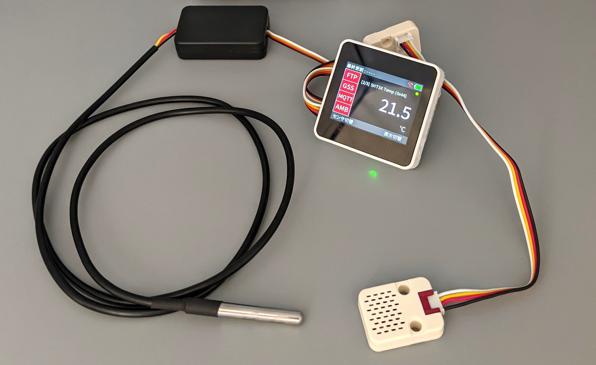

# YRIT IoT Firmware（IoT デバイス用ファームウェア）

<div align="center">
    
</div>

## 📖 概要

山形県工業技術センターが開発した IoT デバイス用のファームウェア（プログラム）です。  
IoT システムを内製したい方や低コストでの IoT 試用にご利用いただけます。

✅ 多数のデバイスをサポート  
✅ デジタル入力、パルスカウント、カメラ画像、各種 I2C センサ、Modbus（RTU）センサ に対応  
✅ 対応している各種センサを自動で認識  
✅ FTP、HTTP、MQTT、Ambient など複数の送信方法に対応  
✅ Wi-Fi 設定や送信先サーバの設定などを、後から簡単に変更可能

## 📦 ダウンロード

本リポジトリを clone または zip でダウンロードし、任意のフォルダに展開する。

## ⚙️ 開発環境

- Arduino IDE (v2.3.6 または v1.8.19)

## 🚀 セットアップ

最初に依存ライブラリをセットアップが必要です。本リポジトリにはセットアップ用に便利なスクリプトが同梱されています。  
スクリプトを使用すると **Arduino ライブラリフォルダ内にあるファイルがすべて削除される** ので注意してください。

```bash
# Windows の場合
.\arduino_library_setter.bat
# Linux の場合
bash arduino_library_setter.sh

> === コピーするプロファイルを選択してください ===
> [1] Common Library Only
> [2] ESP32 Devkit
> [3] M5Stack
> [4] LilyGO
> [5] Wio Terminal
> [6] キャンセル
> プロファイルを選択: 3       # ファームウェアを書き込むデバイスに合わせて番号を選択する

> 指定先フォルダの内容を全て削除します。
> 続行しますか? (Y/N): Y     # 現在の Arduino ライブラリフォルダの中身が削除されるので注意！
> 指定先フォルダをクリア中...
> コピーを開始します...

# コピーの情報が表示されます

> コピーが完了しました。
```

## 🔨 ビルド

Arduino IDE を立ち上げ、ino ファイルを開きます。  
IDE 上から書き込みパラメータの設定を行います。各デバイスの設定値は [ARDUINO_CONFIG_MEMO](./notes/ARDUINO_CONFIG_MEMO.asciidoc) にまとめてあります。

設定後、ビルドを実行します。

<!--
## 👨‍💻 開発者向け

開発環境のセットアップ、ビルド手順については [開発者向けドキュメント](./DEVELOPMENT.md) をご覧ください。
 -->

## 📜 ライセンス

本ソフトウェアはソースコード公開ソフトウェア（Source-Available Software）です。  
[YRIT Software License](./LICENSE) の下で公開されています。  
本ソフトウェアを利用する場合は、[ライセンスの条項](./LICENSE)に同意し、これに従う必要があります。

### ⚠️ 許可事項と制限事項 ⚠️

|         項目         | 可否 | 詳細                                               |
| :------------------: | :--: | -------------------------------------------------- |
|         使用         |  ✅  | 個人・法人問わず、プログラムを自由に使用できます   |
|         改変         |  ✅  | 個人・法人問わず、ソースコードを自由に改変できます |
|        再配布        |  ✅  | 個人・法人問わず、改変版を含め自由に再配布できます |
| 商用製品への組み込み |  🚫  | 製品・サービスへの組み込みは許可されません         |
|   ライセンスの変更   |  🚫  | 改変版も含め、ライセンスを変更することはできません |

詳細については [LICENSE](./LICENSE) ファイルをご確認ください。

### ❗ 重要事項 ❗

- **OSS ではありません**: 本ソフトウェアは[オープンソースソフトウェア（OSS）](https://opensource.org/osd)ではありません
- **著作権表示の維持**: 再配布時は著作権表示とライセンス文を必ず含めてください
- **ライセンスの継承**: 改変版を配布する場合も、ライセンスを継承する必要があります
- **無保証**: 本ソフトウェアは現状のまま提供され、いかなる保証もありません

### 💼 商用利用について 💼

社内ツールとしての利用や、社内で閉じた業務での使用は問題ありません。  
ただし、本ソフトウェアを製品やサービスの一部として組み込んで提供・販売することは許可されていません。  
商用ライセンスが必要な場合は、お問い合わせください。

---

Copyright (C) 2025 Yamagata Research Institute of Technology  
Developed by takkaO
