# ファームウェアアーキテクチャ概要

## 概要

YRIT IoT Firmware は、IoTセンサデバイス向けのデータ収集・送信システムです。

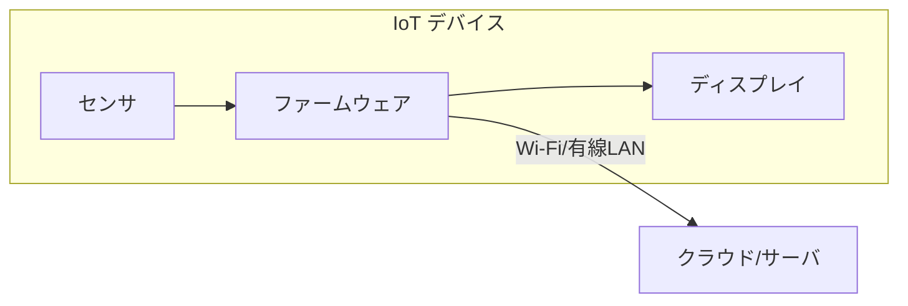

### 特徴

| 特徴 | 説明 |
|-----|------|
| マルチセンサ | GPIO、I2C、Modbus、カメラに対応 |
| マルチプロトコル | Ambient、FTP、HTTP、MQTT で送信可能 |
| マルチデバイス | M5Stack、Wio Terminal など12種類以上に対応 |
| カスタマイズ | センサ追加・表示変更が容易 |

---

## システム構成

### レイヤー構造

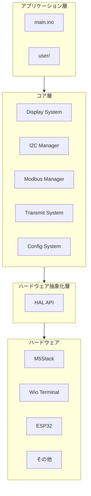

### コンポーネント関係

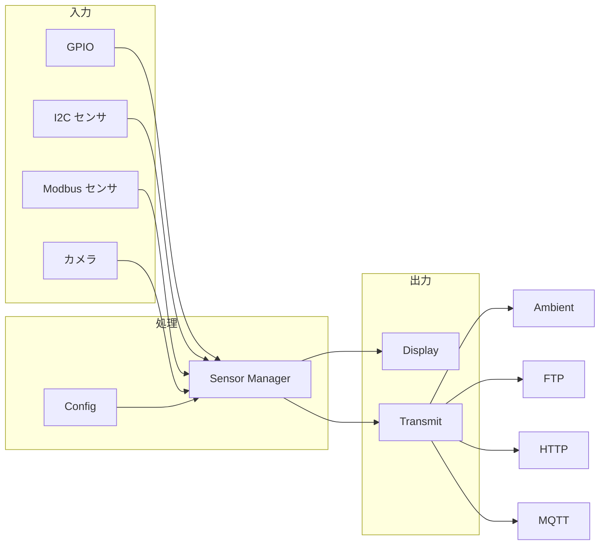

---

## ディレクトリ構成

```
src/
├── config/      # 設定管理
├── display/     # 画面表示
├── hal/         # ハードウェア抽象化
│   └── hardware/   # デバイス固有実装
├── i2c/         # I2C センサ管理
├── modbus/      # Modbus センサ管理
├── transmit/    # データ送信
└── user/        # ユーザーカスタマイズ領域
```

| ディレクトリ | 役割 | 編集 |
|------------|------|:----:|
| `config/` | 設定パラメータ管理 | △ |
| `display/` | 画面表示ロジック | × |
| `hal/` | ハードウェア抽象化 | △ |
| `i2c/` | I2C センサ通信 | △ |
| `modbus/` | Modbus センサ通信 | △ |
| `transmit/` | データ送信処理 | △ |
| **`user/`** | **カスタマイズ領域** | **◎** |

---

## 主要コンポーネント

### 1. HAL (Hardware Abstraction Layer)

ハードウェア固有の処理を抽象化し、同じコードで複数のデバイスに対応します。

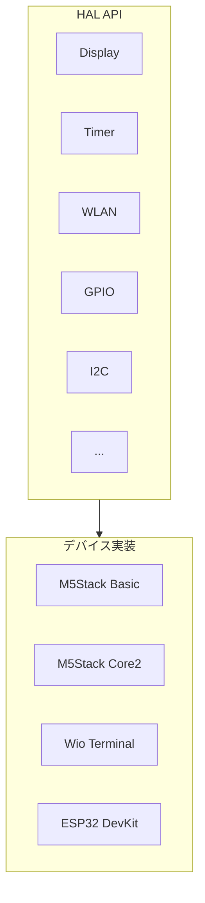

**対応デバイス**:

| シリーズ | デバイス |
|---------|---------|
| M5Stack | Basic, Core2, Core S3, Tough, Atom S3 |
| M5Stick | C Plus, C Plus2 |
| LilyGO | T-Display S3 Pro |
| Seeed | Wio Terminal |
| Espressif | ESP32 DevKit |

### 2. Sensor Manager

全センサを統一的に管理します。

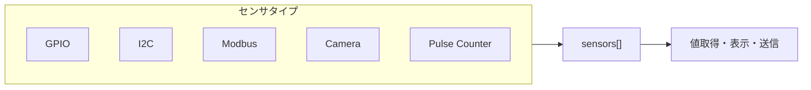

**センサ情報の構造**:

| フィールド | 型 | 説明 |
|-----------|---|------|
| `type` | enum | センサタイプ |
| `name` | String | センサ名 |
| `unit` | String | 単位 |
| `enable` | bool | 有効/無効 |
| `i_value` | int32_t | 整数値 |
| `d_value` | double | 浮動小数点値 |
| `s_value` | String | 文字列値 |

### 3. Transmit System

センサデータをクラウドやサーバに送信します。

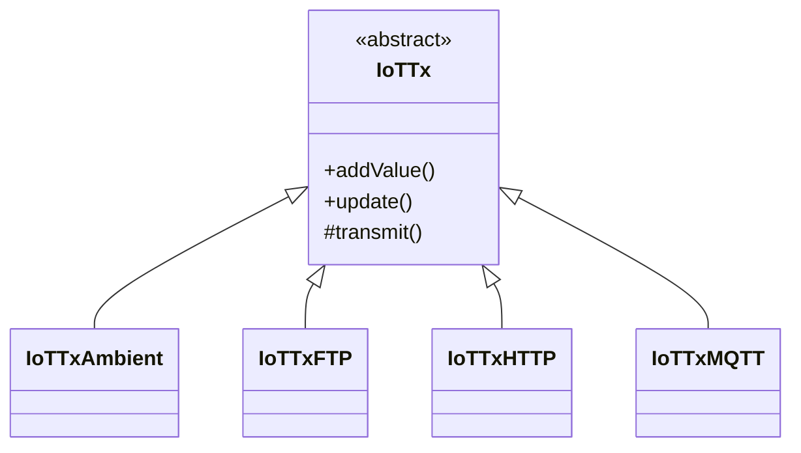

| プロトコル | 用途 |
|-----------|------|
| Ambient | IoT可視化サービス |
| FTP | ファイル転送 |
| HTTP | REST API送信 |
| MQTT | 軽量メッセージング |

### 4. Display System

センサ値や状態を画面に表示します。

| 画面サイズ | 対応デバイス例 |
|-----------|--------------|
| 128×128 | M5Stack Atom S3 |
| 240×135 | M5Stick C Plus |
| 320×240 | M5Stack Basic |
| 222×480 | LilyGO T-Display S3 Pro |

### 5. Config System

JSON形式の設定ファイルを管理します。

| カテゴリ | 設定例 |
|---------|-------|
| 基本 | デバイスID、送信間隔 |
| ネットワーク | Wi-Fi SSID/パスワード、固定IP |
| 送信先 | Ambient、FTP、HTTP、MQTT の接続情報 |
| 機能 | オフラインモード、バッチ送信 |

---

## 処理フロー

### 初期化フロー (setup)

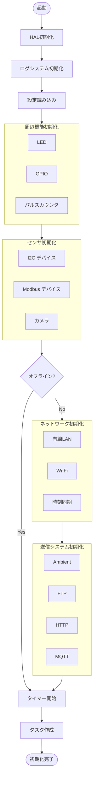

### メインループ (loop)

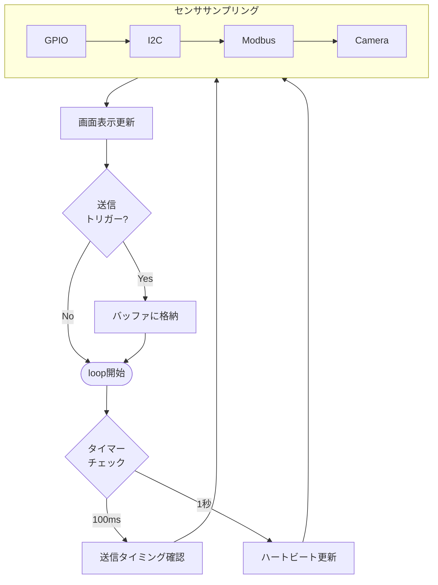

### データフロー

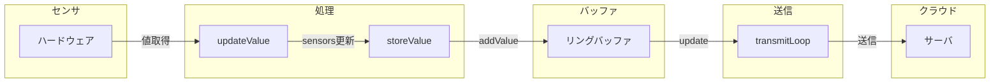

---

## タスクアーキテクチャ

FreeRTOS ベースのマルチタスク構成です。

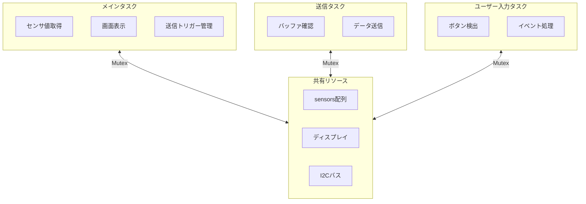

| タスク | 役割 | 間隔 |
|-------|------|-----|
| メインタスク | センサ取得、表示、トリガー管理 | 10ms |
| 送信タスク | データ送信 | 10ms |
| ユーザー入力タスク | ボタン処理 | 10ms |

**排他制御**:

```cpp
// I2Cバスの排他制御
HAL.takeSemaphoreMutex("i2c", portMAX_DELAY);
// I2C通信
HAL.giveSemaphoreMutex("i2c");

// ディスプレイの排他制御
HAL.Display.takeSemaphoreMutex(portMAX_DELAY);
// 描画処理
HAL.Display.returnSemaphoreMutex();
```

---

## 拡張ポイント

### カスタマイズ早見表

| やりたいこと | 編集ファイル | 詳細ドキュメント |
|------------|-------------|-----------------|
| 画面表示を変更 | `user_display_design.cpp` | [HOW_TO_CUSTOMIZE_DISPLAY.md](HOW_TO_CUSTOMIZE_DISPLAY.md) |
| I2Cセンサを追加 | `user_i2c_sensor.cpp` | [HOW_TO_ADD_I2C_SENSOR.md](HOW_TO_ADD_I2C_SENSOR.md) |
| Modbusセンサを追加 | `user_modbus_sensor.cpp` | [HOW_TO_ADD_MODBUS_SENSOR.md](HOW_TO_ADD_MODBUS_SENSOR.md) |
| 新デバイスに対応 | `hal/hardware/` | [HOW_TO_ADD_NEW_DEVICE.md](HOW_TO_ADD_NEW_DEVICE.md) |
| 送信プロトコル追加 | `transmit/` | 下記参照 |

### 送信プロトコルの追加手順

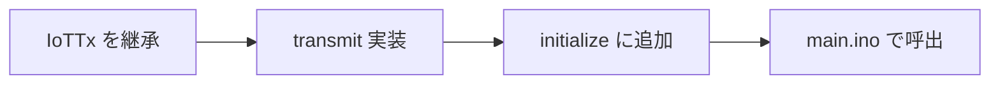

1. `src/transmit/iot_tx_yourprotocol.h/cpp` を作成
2. `IoTTx` を継承し `transmit()` を実装
3. `initialize.cpp` に初期化関数を追加
4. `main.ino` で初期化と更新を呼び出し

---

## 設計原則

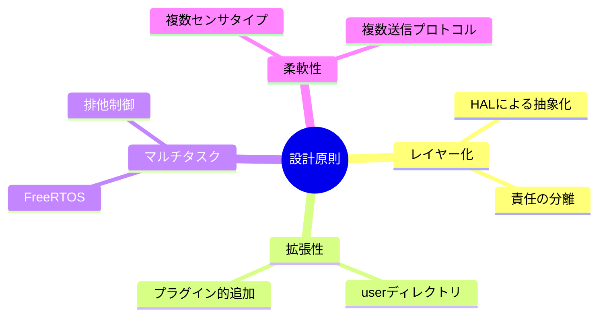

| 原則 | 実現方法 |
|-----|---------|
| レイヤー化 | HAL による抽象化、明確な責任分離 |
| 拡張性 | user ディレクトリ、プラグイン的なセンサ追加 |
| マルチタスク | FreeRTOS による並行処理 |
| 柔軟性 | 複数のセンサタイプ・送信プロトコルに対応 |

---

## 関連ドキュメント

| ドキュメント | 内容 |
|-------------|------|
| [GETTING_STARTED.md](GETTING_STARTED.md) | 開発を始めるためのガイド |
| [DEVICE_SETTINGS.md](DEVICE_SETTINGS.md) | 設定パラメータのリファレンス |
| [SUPPORTED_I2C_DEVICES.md](SUPPORTED_I2C_DEVICES.md) | 対応I2Cセンサ一覧 |
| [SUPPORTED_MODBUS_DEVICES.md](SUPPORTED_MODBUS_DEVICES.md) | 対応Modbusセンサ一覧 |
