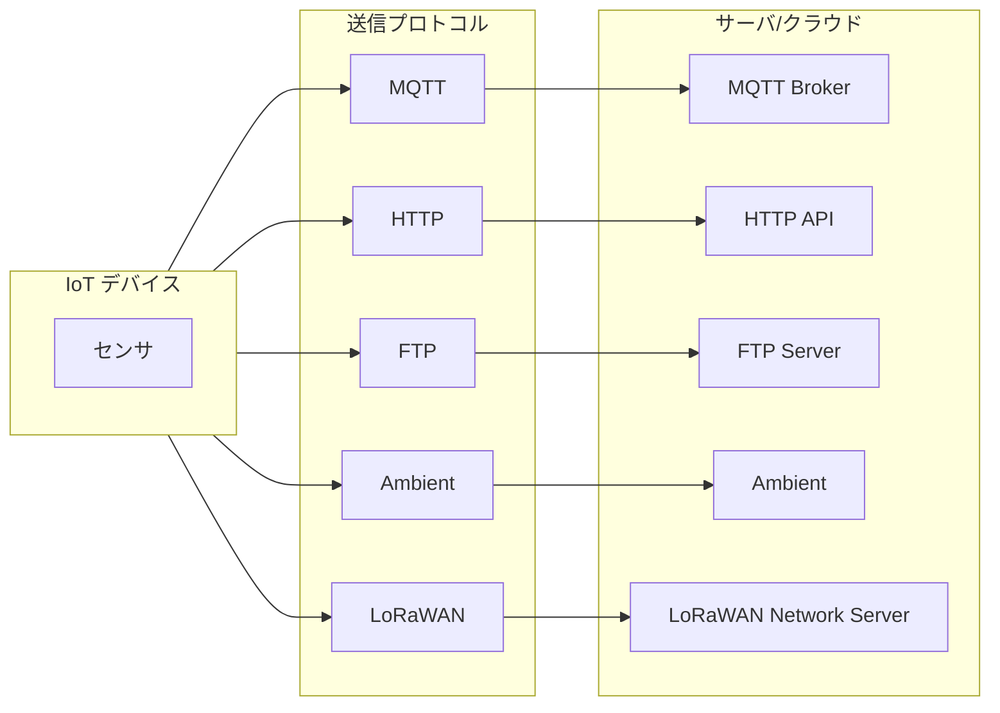
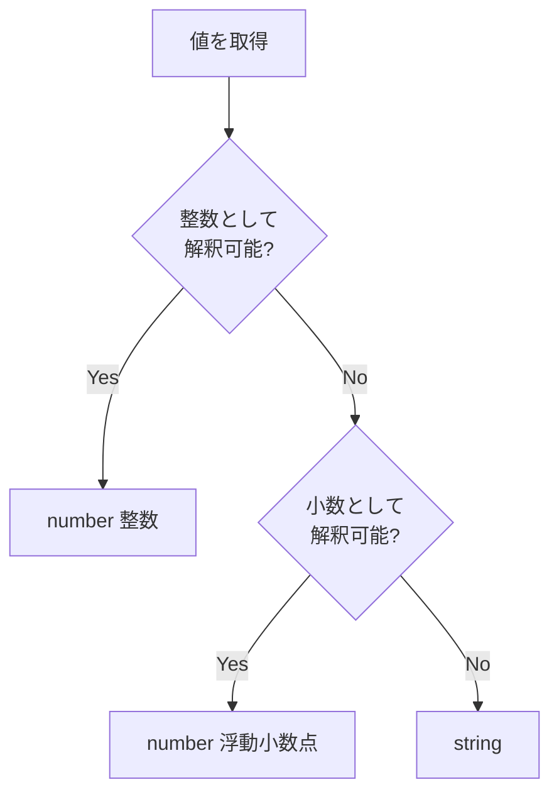

# 送信データフォーマット仕様

このドキュメントでは、YRIT IoT Firmware が送信するデータの形式を説明します。
サーバ側の実装やデータ連携の際にご参照ください。

---

## 概要



| プロトコル | データ形式 | 用途                          |
| ---------- | ---------- | ----------------------------- |
| MQTT       | JSON       | リアルタイム送信、IoT基盤連携 |
| HTTP       | JSON       | REST API送信                  |
| FTP        | CSV        | ファイルベースの蓄積          |
| Ambient    | JSON       | Ambient サービス専用          |
| LoRaWAN    | バイナリ   | 低消費電力・長距離送信        |

---

## MQTT

### トピック構造

```
{base_topic}/{devID}/{sensName}
```

| 要素         | 説明                         | 例                   |
| ------------ | ---------------------------- | -------------------- |
| `base_topic` | 設定で指定するベーストピック | `iot/sensors`        |
| `devID`      | デバイス識別ID               | `01_01`              |
| `sensName`   | センサ名                     | `BME280_Temperature` |

**トピック例**:

```
iot/sensors/01_01/BME280_Temperature
iot/sensors/01_01/BME280_Humidity
```

### 特殊トピック

| 種別         | トピック形式                             |
| ------------ | ---------------------------------------- |
| ハートビート | `Heartbeat/{base_topic}/{devID}/`        |
| カメラ画像   | `Camera/{base_topic}/{devID}/{sensName}` |
| バッチ送信   | `Batch/{base_topic}/{devID}/{sensName}`  |

### ペイロード形式

#### 通常センサ値

```json
{
  "devID": "01_01",
  "sensName": "BME280_Temperature",
  "unit": "℃",
  "day": "2025/01/20 15:30:45",
  "value": 25.6
}
```

| フィールド | 型            | 必須 | 説明                              |
| ---------- | ------------- | :--: | --------------------------------- |
| `devID`    | string        |  ○   | デバイス識別ID                    |
| `sensName` | string        |  ○   | センサ名                          |
| `unit`     | string        |  ○   | 単位                              |
| `day`      | string        |  ○   | 日時（`YYYY/MM/DD HH:MM:SS`形式） |
| `value`    | number/string |  ○   | センサ値（型は値による）          |
| `time`     | number        |  -   | UNIXタイムスタンプ（設定有効時）  |

**value の型**:

- 整数として解釈可能 → `number`（整数）
- 小数として解釈可能 → `number`（浮動小数点）
- それ以外 → `string`

#### UNIXタイムスタンプ付き

設定で `UNIX_TIME_FIELD` を有効にした場合：

```json
{
  "devID": "01_01",
  "sensName": "BME280_Temperature",
  "unit": "℃",
  "day": "2025/01/20 15:30:45",
  "value": 25.6,
  "time": 1737355845
}
```

ナノ秒精度が有効な場合：

```json
{
  "time": 1737355845000000000
}
```

#### ハートビート

```json
{
  "devID": "01_01",
  "sensName": "Heartbeat",
  "day": "2025/01/20 15:30:45"
}
```

#### カメラ画像

```json
{
  "devID": "01_01",
  "sensName": "Camera",
  "unit": "jpg",
  "day": "2025/01/20 15:30:45",
  "value": "/9j/4AAQSkZJRg..."
}
```

| フィールド | 説明                              |
| ---------- | --------------------------------- |
| `value`    | Base64 エンコードされた JPEG 画像 |

#### バッチ送信

複数センサの値を一括送信する場合：

```json
{
  "devID": "01_01",
  "sensName": "BatchData",
  "day": "2025/01/20 15:30:45",
  "sensors": [
    {
      "name": "BME280_Temperature",
      "value": 25.6,
      "unit": "℃"
    },
    {
      "name": "BME280_Humidity",
      "value": 45.2,
      "unit": "%"
    }
  ]
}
```

---

## HTTP

HTTP POST でデータを送信します。

### リクエスト

```
POST {設定したURL} HTTP/1.1
Content-Type: application/json

{ペイロード}
```

### ペイロード形式

MQTT と同一形式です。

#### 通常センサ値

```json
{
  "devID": "01_01",
  "sensName": "BME280_Temperature",
  "unit": "℃",
  "day": "2025/01/20 15:30:45",
  "value": 25.6
}
```

#### カメラ画像

```json
{
  "devID": "01_01",
  "sensName": "Camera",
  "unit": "jpg",
  "day": "2025/01/20 15:30:45",
  "value": "/9j/4AAQSkZJRg..."
}
```

#### バッチ送信

```json
{
  "devID": "01_01",
  "sensName": "BatchData",
  "day": "2025/01/20 15:30:45",
  "sensors": [...]
}
```

### レスポンス

| ステータス | 意味                 |
| ---------- | -------------------- |
| 200        | 成功                 |
| 302        | 成功（リダイレクト） |
| その他     | エラー               |

---

## FTP

CSV 形式でファイルに追記します。

### ディレクトリ構造

```
{設定したパス}/
├── 20250120/
│   └── data.csv
├── 20250121/
│   └── data.csv
└── Camera/
    └── {devID}/
        └── 20250120/
            ├── 20250120_153045.jpg
            └── 20250120_160000.jpg
```

- 日付ごとにディレクトリが作成されます
- カメラ画像は `Camera/{devID}/{YYYYMMDD}/` に保存されます

### CSV 形式

#### ヘッダー

```csv
time, day, value, devID, sensName, unit
```

※ `time` は UNIX タイムスタンプ設定が有効な場合のみ

#### データ行

```csv
1737355845, 2025/01/20 15:30:45, 25.6, 01_01, BME280_Temperature, ℃
1737355845, 2025/01/20 15:30:45, 45.2, 01_01, BME280_Humidity, %
```

| カラム     | 説明                              |
| ---------- | --------------------------------- |
| `time`     | UNIXタイムスタンプ（オプション）  |
| `day`      | 日時（`YYYY/MM/DD HH:MM:SS`形式） |
| `value`    | センサ値                          |
| `devID`    | デバイス識別ID                    |
| `sensName` | センサ名                          |
| `unit`     | 単位                              |

### ハートビートファイル

設定したパスに日時のみを書き込みます。

```
2025/01/20 15:30:45
```

### カメラ画像

JPEG 形式のバイナリファイルとして保存されます。

ファイル名: `YYYYMMDD_HHMMSS.jpg`

---

## Ambient

[Ambient](https://ambidata.io/) サービス専用の形式です。

### リクエスト

Ambient API に対して以下の形式で送信します。

```json
{
  "writeKey": "ライトキー",
  "data": [
    {
      "d1": 25.6,
      "d2": 45.2,
      "d3": 1013.25,
      "created": "2025-01-20 15:30:45.000"
    }
  ]
}
```

| フィールド        | 説明                                  |
| ----------------- | ------------------------------------- |
| `writeKey`        | Ambient のライトキー                  |
| `data[].d1`〜`d8` | データフィールド（最大8つ）           |
| `data[].created`  | 日時（`YYYY-MM-DD HH:MM:SS.mmm`形式） |

### データマッピング

設定でセンサ名と d1〜d8 の対応を指定します。

| 設定キー         | 説明                    |
| ---------------- | ----------------------- |
| `D1_SENSOR_NAME` | d1 に割り当てるセンサ名 |
| `D2_SENSOR_NAME` | d2 に割り当てるセンサ名 |
| ...              | ...                     |

**例**: `D1_SENSOR_NAME` = `BME280_Temperature` の場合、BME280 の温度値が `d1` に送信されます。

---

## LoRaWAN

LoRaWAN はペイロードサイズの制約が非常に厳しいため、他のプロトコルのような JSON/CSV ではなく、**独自のバイナリ形式**で送信します。

### ペイロードサイズの制約

```cpp
#define LORAWAN_MAX_PAYLOAD_SIZE (53)
```

AS923 リージョンの DR3 を最小データレートとして想定した値です（Dwell Time 制約により DR2 未満は使用できず、DR2 では 11byte しか送信できません）。

### センサ名とセンサ値を分けて送信

1 回のセンサ値送信につき、**「センサ名」と「センサ値」を別々の FPort で 2 回に分けてアップリンク**します。送信間は TX + RX1/RX2 ウィンドウの完了を待ってから次を送信します。

| 種別     | FPort（デフォルト） | 設定キー                             |
| -------- | :-----------------: | ------------------------------------ |
| センサ名 |          9          | `setLoRaWanParam()` の `fport_name`  |
| センサ値 |         10          | `setLoRaWanParam()` の `fport_value` |

> ⚠️ FPort は 1〜223 の範囲で設定する必要があります。

### ペア番号（pair_id）

センサ名とセンサ値は別々のアップリンクになるため、両者を紐付けるための **ペア番号（1byte）** を先頭に付与します。同じペア番号を持つ「センサ名」と「センサ値」が対になります。

### センサ名ペイロード

| オフセット | サイズ | 内容                                                                  |
| :--------: | :----: | --------------------------------------------------------------------- |
|     0      | 1 byte | ペア番号                                                              |
|    1〜     | 可変長 | センサ名（ASCII、null終端なし。ペイロード上限を超える場合は切り詰め） |

### センサ値ペイロード

| オフセット |   サイズ    | 内容                                                        |
| :--------: | :---------: | ----------------------------------------------------------- |
|     0      |   1 byte    | ペア番号（センサ名ペイロードと同じ値）                      |
|     1      |   1 byte    | データタイプ                                                |
|    2〜     | 4 or 8 byte | 値（データタイプにより可変）                                |
| 値の直後〜 |   可変長    | 単位（ASCII、null終端なし。残り領域を超える場合は切り詰め） |

**データタイプ**:

|   値   | 定数名                    | 内容                                   | 値のサイズ |
| :----: | ------------------------- | -------------------------------------- | :--------: |
| `0x01` | `LORAWAN_DATATYPE_INT32`  | 32bit 整数（リトルエンディアン）       |   4 byte   |
| `0x02` | `LORAWAN_DATATYPE_DOUBLE` | 64bit 浮動小数点（リトルエンディアン） |   8 byte   |

> ⚠️ 数値に変換できない値（文字列型）は現時点では非対応で、送信されません。

**送信例**（`BME280_Temperature` = `25.6℃`、ペア番号 `3` の場合）:

```
センサ名ペイロード (FPort 9):
  03 42 4D 45 32 38 30 5F 54 65 6D 70 65 72 61 74 75 72 65
  ^^ ^^^^^^^^^^^^^^^^^^^^^^^^^^^^^^^^^^^^^^^^^^^^^^^^^^^^^
  |  "BME280_Temperature"
  ペア番号(3)

センサ値ペイロード (FPort 10):
  03 02 [25.6 を表す8byteのdouble値(LE)] E2 84 83
  ^^ ^^ ^^^^^^^^^^^^^^^^^^^^^^^^^^^^^^^^ ^^^^^^^^
  |  |  double値                        "℃"(UTF-8)
  |  データタイプ(DOUBLE)
  ペア番号(3)
```

---

## データ型の判定

送信時、`value` の型は以下のロジックで判定されます。



**例**:
| 値 | JSON での型 |
|----|------------|
| `25` | `"value": 25` (number) |
| `25.6` | `"value": 25.6` (number) |
| `"ON"` | `"value": "ON"` (string) |
| `"N/A"` | `"value": "N/A"` (string) |

---

## 設定項目との対応

### 共通設定

| 設定キー          | 影響                              |
| ----------------- | --------------------------------- |
| `devID`           | 全プロトコルの `devID` フィールド |
| `TX_INTERVAL_SEC` | 送信間隔                          |

### MQTT 設定

| 設定キー          | 影響                     |
| ----------------- | ------------------------ |
| `BROKER`          | 接続先ブローカー         |
| `PORT`            | ポート番号               |
| `BASE_TOPIC`      | トピックのプレフィックス |
| `USER` / `PASS`   | 認証情報                 |
| `RETAIN`          | Retain フラグ            |
| `UNIX_TIME_FIELD` | `time` フィールドの追加  |
| `UNIX_TIME_NANO`  | ナノ秒精度の有効化       |

### HTTP 設定

| 設定キー          | 影響                    |
| ----------------- | ----------------------- |
| `URL`             | 送信先URL               |
| `UNIX_TIME_FIELD` | `time` フィールドの追加 |
| `UNIX_TIME_NANO`  | ナノ秒精度の有効化      |

### FTP 設定

| 設定キー          | 影響                |
| ----------------- | ------------------- |
| `SERVER`          | FTPサーバアドレス   |
| `USER` / `PASS`   | 認証情報            |
| `CURRENT_DIR`     | 保存先ディレクトリ  |
| `FILE_NAME`       | CSVファイル名       |
| `UNIX_TIME_FIELD` | `time` カラムの追加 |
| `UNIX_TIME_NANO`  | ナノ秒精度の有効化  |

### Ambient 設定

| 設定キー                           | 影響             |
| ---------------------------------- | ---------------- |
| `CHANNEL_ID`                       | チャンネルID     |
| `WRITE_KEY`                        | ライトキー       |
| `D1_SENSOR_NAME`〜`D8_SENSOR_NAME` | データマッピング |

### LoRaWAN 設定

すべて `LORA_WAN` セクション配下の設定キーです。

| 設定キー                                           | 影響                                                       |
| -------------------------------------------------- | ---------------------------------------------------------- |
| `ABP`                                              | `true` の場合 ABP、`false`（デフォルト）の場合 OTAA で接続 |
| `OTAA_DEV_EUI` / `OTAA_JOIN_EUI` / `OTAA_APP_KEY`  | OTAA 接続時の認証情報                                      |
| `ABP_DEV_ADDR` / `ABP_NWK_S_KEY` / `ABP_APP_S_KEY` | ABP 接続時の認証情報                                       |
| `FPORT_NAME`                                       | センサ名送信用 FPort                                       |
| `FPORT_VALUE`                                      | センサ値送信用 FPort                                       |

> ⚠️ `FPORT_NAME`/`FPORT_VALUE` に `199` を指定すると初期化に失敗します（WM1110 モジュールがメトリクス収集用に予約しているため）。

---

## サーバ実装例

### Node.js (HTTP)

```javascript
const express = require("express");
const app = express();

app.use(express.json());

app.post("/api/sensor", (req, res) => {
  const { devID, sensName, value, day, unit, time } = req.body;

  console.log(`Device: ${devID}`);
  console.log(`Sensor: ${sensName}`);
  console.log(`Value: ${value} ${unit}`);
  console.log(`Time: ${day}`);

  // データベースに保存など

  res.status(200).send("OK");
});

app.listen(3000);
```

### Python (MQTT)

```python
import paho.mqtt.client as mqtt
import json

def on_message(client, userdata, msg):
    data = json.loads(msg.payload.decode())

    print(f"Topic: {msg.topic}")
    print(f"Device: {data['devID']}")
    print(f"Sensor: {data['sensName']}")
    print(f"Value: {data['value']} {data['unit']}")
    print(f"Time: {data['day']}")

client = mqtt.Client()
client.on_message = on_message
client.connect("broker.example.com", 1883)
client.subscribe("iot/sensors/#")
client.loop_forever()
```

---

## 関連ドキュメント

| ドキュメント                                         | 内容               |
| ---------------------------------------------------- | ------------------ |
| [DEVICE_SETTINGS.md](DEVICE_SETTINGS.md)             | 送信設定の詳細     |
| [ARCHITECTURE_OVERVIEW.md](ARCHITECTURE_OVERVIEW.md) | 送信システムの構造 |
