# I2C センサの追加方法（標準センサ）

本ドキュメントでは、`i2c/i2c_manager.cpp` に I2C センサを追加する方法を説明します。

## 📚 前提知識

このドキュメントを読む前に、以下を理解しておくことを推奨します。

- **C++の基本文法**: クラス、ポインタ、関数の定義など
- **I2C 通信の基本**: I2C アドレス、通信フロー、レジスタの概念
- **センサの基本情報**: レジスタマップ、デバイス ID、データ変換式など
- **I2C センサの追加方法（ユーザーセンサ）の内容**: user_i2c_sensor.cpp への追加方法

## 📌 重要な注意事項

**通常のユーザーは [I2C センサの追加方法（ユーザーセンサ）](./HOW_TO_ADD_I2C_SENSOR.md) を参照してください。**

標準センサ（`i2c_manager.cpp`）への追加が必要となる場面は、I2C マルチプレクサや 1-Wire to I2C ブリッジなどの特殊なデバイスを追加する場合になるでしょう。単純な I2C センサを追加する場合はユーザーセンサ（`user_i2c_sensor.cpp`）への追加を検討してください。

## 📁 プロジェクトの構成

YRIT IoT Firmware は、I2C センサを **標準センサ** と **ユーザーセンサ** の 2 つに分けて管理しています。

### 🗂️ ディレクトリ構成

```
src/
├── i2c/                            # ファームウェア標準センサ
│   ├── i2c_manager.h               # 標準I2Cセンサの関数宣言
│   ├── i2c_manager.cpp             # 標準I2Cセンサの処理（ここに処理を追加する）
│   └── i2c_type_def.h              # 型定義
│
└── user/                           # ユーザー追加領域
    ├── user_i2c_sensor.h           # ユーザーI2Cセンサの関数宣言
    ├── user_i2c_sensor.cpp         # ユーザーI2Cセンサの統合処理
    ├── user_modbus_sensor.h/cpp    # ユーザーModbusセンサ（別ドキュメント参照）
    └── user_sensors/
        ├── i2c_sensors/            #  ユーザーセンサ用ライブラリ
        │   └── i2c_ct_unit.h/cpp   # （実装例）
        └── modbus_sensors/         # Modbusセンサ用（別ドキュメント参照）
```

### ⚖️ 標準センサとユーザーセンサの違い

本ドキュメントでは標準センサ側（`i2c_manager.cpp`）にセンサを追加する方法について解説します。

|                      | 標準センサ（`i2c_manager.cpp`） | ユーザーセンサ（`user_i2c_sensor.cpp`） |
| -------------------- | ------------------------------- | --------------------------------------- |
| **編集するファイル** | `src/i2c/i2c_manager.cpp`       | `src/user/user_i2c_sensor.cpp`          |
| **処理内容**         | センサ処理 + 周辺処理           | センサ処理のみ                          |
| **実装の複雑さ**     | 複雑                            | シンプル（センサに関する処理のみ）      |
| **処理の優先度**     | 後で処理される                  | 先に処理される                          |
| **使用する場面**     | 標準センサとして組み込む時      | 追加のセンサを使用する時                |

## 📋 プログラム概要

プログラムがどのようにセンサを検出しデータを取得するか、ユーザはどのような処理を書かなければならないのかを説明します。

### 🔄 センサ初期化の流れ

センサは下記フローに従って検出と初期化が行われます。

<!-- For Markdown -->
<div align="center">
    
</div>

<!-- For Doxygen -->
<div align="center">
    
</div>

### 📊 センサデータ取得の流れ

初期化完了後、センサデータは定期的に以下のフローで取得されます。

<!-- For Markdown -->
<div align="center">
    
</div>

<!-- For Doxygen -->
<div align="center">
    
</div>

### 📝 実装しなければならない処理

センサを追加する場合、ユーザは下記の処理を `i2c_manager.cpp` に実装する必要があります。これらの関数はファームウェアのメインループから呼び出されます。

| 処理             | 概要                             | 関数名                          |
| ---------------- | -------------------------------- | ------------------------------- |
| センサ初期化処理 | センサの初期化のための処理       | `I2C_Manager::initializeDevice` |
| センサ名取得処理 | センサ名とデータ種別を返す処理   | `I2C_Manager::getDeviceName`    |
| 単位取得処理     | データの単位を返す処理           | `I2C_Manager::getDeviceUnit`    |
| データ取得処理   | センサから実際の値を取得する処理 | `I2C_Manager::fetchData`        |

---

### 🗃️ データ構造

標準センサは、4 次元マップとセンサリストクラスを組み合わせて管理されています。

#### 全体構造

```cpp
std::map<int, std::map<int, std::map<int, std::map<int, I2C_Sensor_List>>>> i2c_sensors;
          ↑             ↑             ↑             ↑            ↑
        port        address     bus_channel   sub_address   センサリスト
```

#### アクセス方法

```cpp
i2c_sensors[port][address][bus_channel][sub_address].your_sensor
     ↑        ↑       ↑           ↑            ↑            ↑
４次元マップ  ポート  I2Cアドレス  バスチャネル  サブアドレス  センサインスタンス
```

|  パラメータ   | 説明                               |  値の範囲   | 例                                                |
| :-----------: | ---------------------------------- | :---------: | ------------------------------------------------- |
|    `port`     | I2C ポート番号                     |    0 ~ N    | M5Stack の Grove I2C ポート A1 (0), A2 (1) など   |
|   `address`   | メイン I2C アドレス                | 0x00 ~ 0x7F | 0x48, 0x76 など                                   |
| `bus_channel` | マルチプレクサのチャネル           |   -1 ~ M    | -1（直接接続）、0〜M（マルチプレクサのチャネル）  |
| `sub_address` | マルチプレクサ配下のセンサアドレス | 0x00 ~ 0x7F | 直接接続の場合はメイン I2C アドレスと同じ値が入る |

#### I2C_Sensor_List クラス

`i2c_sensors[port][address][bus_channel][sub_address]` でアクセスすると、以下のようなセンサリストクラスのインスタンスが得られます。

```cpp
class I2C_Sensor_List {
public:
    std::unique_ptr<Sensor0> sensor0;
    std::unique_ptr<Sensor1> sensor1;
    std::unique_ptr<Sensor2> sensor2;
    ...
};
```

各センサは `std::unique_ptr` で管理され、有効なセンサオブジェクトのみメモリに展開されます。
この構造により、有効なセンサへのアクセスが明快に記述できる他、同じアドレスのセンサでも異なるポートやマルチプレクサチャネルなら区別可能になります。

##### 使用例

```cpp
// ポート0、アドレス0x48のセンサ（直接接続）
i2c_sensors[0][0x48][-1][0x48].your_sensor

// ポート1、アドレス0x48のセンサ（異なるポート → 別のセンサとして扱われる）
i2c_sensors[1][0x48][-1][0x48].your_sensor

// ポート0、マルチプレクサ(0x70)のチャネル2、アドレス0x48のセンサ
i2c_sensors[0][0x70][2][0x48].your_sensor
```

---

## 🔧 実装の流れ

i2c_manager.cpp へのセンサ追加は、大きく分けて **2 つのステップ** で行います。

### 🛠️ ステップ 1: センサ用のライブラリを作る

まず、センサ専用のプログラム（クラス）を作ります。これは「センサとの通信やデータ処理」を定義するもので、ファームウェアから独立した再利用可能なライブラリであり、一般的な Arduino で利用されるセンサライブラリと同じ形式です。

#### ファイル配置

i2c_manager.cpp で管理するセンサはファームウェア標準として扱われるため、Arduino ライブラリとして配置することを推奨します。
Arduino ライブラリに追加する場合は、ビルド再現性の向上のためにプロジェクト直下の libraries フォルダ内にも作成したライブラリを追加してください（`libraries/common/YourSensor/Library`）。

```
user_i2c_sensor の場合:
src/user/user_sensors/i2c_sensors/
├── your_sensor.h
└── your_sensor.cpp

i2c_manager の場合（推奨）:
libraries/
└── YourSensorLibrary/
    ├── YourSensor.h
    └── YourSensor.cpp
```

#### 実装上の注意点

ライブラリを実装する際は、以下の点に注意してください。

##### 1. クラスとして定義する

コードはクラスとして実装し、インスタンス化して利用できるようにしなければなりません。これにより、複数のセンサを同時に扱う場合や、同じセンサを複数個使用する場合にも対応できます。

##### 2. 初期化メソッドで Wire オブジェクトを受け取る

初期化メソッドの引数で Wire オブジェクトを受け取るようにしなければなりません。
受け取り方は `TwoWire` 型のポインタ渡しか参照渡しで受け取ることが望ましいです。
ファームウェアは複数の I2C バス（Wire、Wire1 など）を管理しているため、どの I2C バスを使用するかを外部から指定できるようにする必要があります。より利便性を向上するために、ポインタ渡しの場合はデフォルト引数に `Wire` のポインタを指定しておくと良いでしょう。

```cpp
// ✅実装例（ポインタ渡し）
bool init(TwoWire *wire);          // デフォルト引数なし
bool init(TwoWire *wire = &Wire);  // デフォルト引数あり

// ✅実装例（参照渡し）
bool init(TwoWire& wire);
```

##### 3. 初期化メソッドで受け取った Wire オブジェクトを使用して通信する

ライブラリ内での I2C 通信には、初期化メソッドで受け取った `Wire` オブジェクトを使用します。グローバルな `Wire` オブジェクトを直接使用しないでください。ファームウェアが指定した I2C バスで通信を行う必要があり、誤ったバスで通信するとセンサと正常に通信できなくなります。

```cpp
// ✅実装例（ポインタ渡しの場合）
bool init(TwoWire *wire) {
    _wire = wire;
    _wire->beginTransmission(slave_address);
    _wire->endTransmission();
}

// ✅実装例（参照渡しの場合）
bool init(TwoWire& wire) {
    _wire = wire;
    _wire.beginTransmission(slave_address);
    _wire.endTransmission();
}

// ❌不適切な実装例
bool init() {
    // グローバルな Wire オブジェクトを使用している
    Wire.beginTransmission(slave_address);
    Wire.endTransmission();
}
```

##### 4. 初期化メソッドでセンサを同定する

WHO_AM_I レジスタなどのセンサ固有のレジスタを読み取ってセンサの同定を行い、初期化の成否を `bool` 型の戻り値で返すことが望ましいです（`true`: 該当センサ、`false`: 別のセンサ など）。同じ I2C アドレスを使用するセンサは複数存在するため、デバイス ID などで正しく識別する必要があります。識別を行わないと、間違ったセンサとして処理されてしまう可能性があります。
ただし、一部のセンサにはそのようなレジスタが存在しないものもあるため、難しい場合は省略しても構いません。

```cpp
// ✅実装例
bool init(TwoWire *wire) {
    _wire = wire;

    // センサ固有のレジスタを読み出し
    _wire->beginTransmission(slave_address);
    _wire->write(addr_who_am_i);
    _wire->endTransmission();

    // センサの同定
    uint8_t num = _wire->requestFrom((uint8_t)slave_address, size, (uint8_t)true);
    if (_wire->read() != WHO_AM_I_VALUE) {
        return false;
    }

    // センサ初期化処理
    _wire->beginTransmission(slave_address);
    _wire->write(config);
    _wire->endTransmission();

    return true;
}
```

### 🧩 ステップ 2: ファームウェアに組み込む

次に、作ったセンサライブラリを使って、該当の I2C センサをファームウェアに組み込みます。`i2c_manager.cpp` に以下の処理を追加します。

```
(1) インクルード追加     ← センサライブラリを読み込む
(2) 宣言追加           ← センサ用の変数を用意する
(3) 初期化処理         ← センサを検出して初期化と同定を行う
(4) センサ名取得処理   ← 識別用のセンサ名と種別名を返す
(5) 単位取得処理       ← データの単位を返す
(6) データ取得処理     ← 実際のセンサデータを取得する
```

#### (1) インクルードファイルの追加

`src/i2c/i2c_manager.cpp` のインクルードセクションに追加。

```cpp
// I2C sensor libraries
#include <Adafruit_SHT31.h>
#include <Bme280TwoWire.h>
// ... 既存のインクルード ...
#include <YourSensor.h>  // ← 追加
```

#### (2) I2C_Sensor_List クラスへの宣言追加

`I2C_Sensor_List` クラスにセンサインスタンスを追加。

```cpp
class I2C_Sensor_List {
public:
    // Supported sensors
    std::unique_ptr<VL53L0X> vl53l0x;
    std::unique_ptr<Adafruit_SHT31> sht3x;
    // ... 既存のセンサ ...
    std::unique_ptr<YourSensor> your_sensor;  // ← 追加
};
```

**注意点:**

- `unique_ptr` を使用してメモリ管理を行います
- センサリストの順序は特に重要ではありませんが、アルファベット順や用途別に整理することを推奨します

> **💡`std::unique_ptr` とは？**  
> C++ でメモリを自動管理するスマートポインタの一種です。本ファームウェアでは、センサオブジェクトの確保と解放を自動で行うことでメモリリークを防ぎ、実際に接続されているセンサのみメモリを確保することで効率的なメモリ使用を実現しています。

#### (3) 初期化処理の実装

`I2C_Manager::initializeDevice()` 関数の `switch` 文にセンサを検出して初期化する処理を追加します。

**例：I2C アドレス 0x48 のセンサの場合**

まずは、該当するアドレスの case 文を追加し、センサの初期化ブロックを実装します。

```cpp
case 0x48:  // ← センサのI2Cアドレス（データシートで確認）
    // まだセンサが作られていない場合のみ実行
    if (!i2c_sensors[port][address][bus_channel][sub_address].your_sensor) {

    }
    break;
```

次にセンサクラスのインスタンスを作成します。

```cpp
case 0x48:
    if (!i2c_sensors[port][address][bus_channel][sub_address].your_sensor) {
        // センサクラスのインスタンスを作成
        i2c_sensors[port][address][bus_channel][sub_address].your_sensor.reset(new YourSensor());
    }
    break;
```

最後に、センサの初期化メソッドの呼び出しを行います。
メソッドの呼び出しは `i2c_sensors[port][address][bus_channel][sub_address].your_sensor->init(_wire, _address)` のように `i2c_sensors[port][address][bus_channel][sub_address].your_sensor->メソッド名()` で呼び出します。
現在使用中の I2C バスオブジェクトは、`_wire` に格納されており、これは I2C バスオブジェクト（Wire オブジェクト）へのポインタになっています。
初期化が成功した場合は取得可能なデータ数を `I2C_INIT_RESULT` 型の値で返します。
初期化に失敗した場合はメモリを解放し、他のセンサの初期化のためにバスをリセットします。

```cpp
case 0x48:
    if (!i2c_sensors[port][address][bus_channel][sub_address].your_sensor) {
        i2c_sensors[port][address][bus_channel][sub_address].your_sensor.reset(new YourSensor());

        // センサの初期化メソッドを呼んで初期化を行う
        if (i2c_sensors[port][address][bus_channel][sub_address].your_sensor->init(_wire, _address)) {
            // 初期化に成功した場合（該当センサであった場合）
            return I2C_2_DATA_DEVICE;  // 取得可能なデータ数を返す（例は2種類の場合）
        } else {
            // 初期化に失敗した場合（別のセンサであった場合）
            i2c_sensors[port][address][bus_channel][sub_address].your_sensor.reset();    // メモリを解放

            // I2Cバスをリセット（次のセンサ検出のため）
            _wire->end();
            HAL.delay(20);
            _wire->begin();
        }
    }
    break;
```

ここまでで初期化処理の実装は完了です。
最後に省略部分を含めた初期化関数の実装例を下記に示します。

```cpp
I2C_INIT_RESULT I2C_Manager::initializeDevice(uint8_t port,
                                              uint8_t address,
                                              int8_t bus_channel,
                                              uint8_t sub_address,
                                              bool use_sub_addr) {
    // ユーザーセンサの初期化処理
    I2C_INIT_RESULT user_init = I2C_IGNORE_DEVICE;
    uint8_t _address = address;
    auto _wire = HAL.I2c.getWire(port);  // I2C通信用のオブジェクト取得
    // ... ユーザーセンサのチェック ...

    switch (_address) {
    // ... 既存のセンサ ...

    case 0x48:  // ← センサのI2Cアドレス（データシートで確認）
        // まだセンサが作られていない場合のみ実行
        if (!i2c_sensors[port][address][bus_channel][sub_address].your_sensor) {
            // センサクラスのインスタンスを作成
            i2c_sensors[port][address][bus_channel][sub_address].your_sensor.reset(new YourSensor());

            // センサの初期化メソッドを呼んで初期化を行う
            if (i2c_sensors[port][address][bus_channel][sub_address].your_sensor->init(_wire, _address)) {
                // 初期化に成功した場合（該当センサであった場合）
                return I2C_2_DATA_DEVICE;  // 取得可能なデータ数を返す（例は2種類の場合）
            } else {
                // 初期化に失敗した場合（別のセンサであった場合）
                i2c_sensors[port][address][bus_channel][sub_address].your_sensor.reset();    // メモリを解放

                // I2Cバスをリセット（次のセンサ検出のため）
                _wire->end();
                HAL.delay(20);
                _wire->begin();
            }
        }
        break;
    // ... その他のセンサ ...

    }

    return I2C_IGNORE_DEVICE;  // 該当センサではない
}
```

> **💡 I2C_INIT_RESULT**  
> センサを初期化した時の結果を表す値です。「このセンサは何種類のデータを取得できるか」を返します。
>
> ```cpp
> enum I2C_INIT_RESULT {
>     I2C_IGNORE_DEVICE = -1,    // 未知のデバイス（サポート外のデバイス）
>     I2C_0_DATA_DEVICE = 0,     // データは取得しない（マルチプレクサなど）
>     I2C_1_DATA_DEVICE = 1,     // 1種類のデータを取得できる
>     I2C_2_DATA_DEVICE = 2,     // 2種類のデータを取得できる
>     I2C_3_DATA_DEVICE = 3,     // 3種類のデータを取得できる
>     // ... 最大 30 種類まで
> };
> ```
>
> 例えば、温度と湿度など、2 つ値を取得できるセンサの場合は `I2C_2_DATA_DEVICE` を返します。
> 距離しか取得できないセンサの場合は `I2C_1_DATA_DEVICE` を返します。

#### (4) センサ名取得処理の実装

`I2C_Manager::getDeviceName()` 関数の `switch` 文にセンサ名の取得処理を追加します。

**例：I2C アドレス 0x48 のセンサの場合**

まずは、該当するアドレスの case 文を追加します。

```cpp
case 0x48:
    if (i2c_sensors[port][address][bus_channel][sub_address].your_sensor) {

    }
    break;
```

次に、`sub_id` に応じてセンサ名を返す処理を追加します。

```cpp
case 0x48:
    if (i2c_sensors[port][address][bus_channel][sub_address].your_sensor) {
        // sub_id に応じて名前を変える
        switch (sub_id) {
        case 0:  // 1つ目のデータ（例：温度）
            return "YourSensor_Temperature_(" + String(s_addr) + ")";
        case 1:  // 2つ目のデータ（例：湿度）
            return "YourSensor_Humidity_(" + String(s_addr) + ")";
        default:
            return "YourSensor";
        }
    }
    break;
```

ここまででセンサ名取得処理の実装は完了です。
最後に省略部分を含めた完全な実装例を下記に示します。

```cpp
String I2C_Manager::getDeviceName(uint8_t port,
                                  uint8_t address,
                                  int8_t bus_channel,
                                  uint8_t sub_address,
                                  int16_t sub_id,
                                  bool use_sub_addr) {
    uint8_t _address = use_sub_addr ? sub_address : address;
    char s_addr[5] = {0};
    snprintf(s_addr, 5, "0x%02X", _address);  // アドレスを文字列化（例："0x48"）

    // ユーザーセンサのチェック（最初に呼ばれます）
    String user_name = getUserI2cDeviceName(port, _address, sub_id, !use_sub_addr);
    if (user_name != "") {
        return user_name;
    }

    switch (_address) {
    // ... 既存のセンサ ...

    case 0x48:
        if (i2c_sensors[port][address][bus_channel][sub_address].your_sensor) {
            // sub_id に応じて名前を変える
            switch (sub_id) {
            case 0:  // 1つ目のデータ
                return "YourSensor_Temperature_(" + String(s_addr) + ")";
            case 1:  // 2つ目のデータ
                return "YourSensor_Humidity_(" + String(s_addr) + ")";
            default:
                return "YourSensor";  // 範囲外（通常は来ない）
            }
        }
        break;
    // ... その他のセンサ ...

    }

    return "";
}
```

**センサ名の命名規則:**

`sub_id` に応じてセンサ名を返す処理を追加します。`sub_id` は「何番目のデータか」を示す番号で、`sub_id = 0` が 1 つ目、`sub_id = 1` が 2 つ目のデータに対応します。

センサ名は `sub_id` に応じて `センサ名_データ種別_(I2Cアドレス)` を返すようにし、デフォルトでは `センサ名` だけを返すようにしてください。データを 1 種類しか取得できないデバイスの場合は「データ種別」を省略しても構いません。

**注意点:**

- 返すセンサ名は必ず ASCII 文字である必要があります
- I2C アドレスは関数上部で char 型に変換され、`s_addr` という変数に格納されています
- `sub_id` をどのデータ種別に割り当てるかは自由に決めて良いですが、以降の実装においても一貫性を持たせる必要があります

> **💡 命名規則**  
> センサ名の形式は、取得するデータ数に応じて以下のように設定することが望ましいです。
>
> | データ数   | 名前の形式                       | 例                         |
> | ---------- | -------------------------------- | -------------------------- |
> | 1 種類のみ | `センサ名_(アドレス)`            | `LM75_(0x48)`              |
> | 複数種類   | `センサ名_データ種別_(アドレス)` | `SHT31_Temperature_(0x44)` |

#### (5) 単位取得処理の実装

`I2C_Manager::getDeviceUnit()` 関数の `switch` 文に単位の取得処理を追加します。

**例：I2C アドレス 0x48 のセンサの場合**

まずは、該当するアドレスの case 文を追加します。

```cpp
case 0x48:
    if (i2c_sensors[port][address][bus_channel][sub_address].your_sensor) {

    }
    break;
```

次に、`sub_id` に応じて単位を返す処理を追加します。
`sub_id` の割り当ては `(4) センサ名取得処理` で決めたものと一致させる必要があります。

単位は測定するデータの種類に応じて適切なものを選んでください。ただし、単位の文字列は ASCII 文字での表記（例：`'C`）を使用する必要があります。

```cpp
case 0x48:
    if (i2c_sensors[port][address][bus_channel][sub_address].your_sensor) {
        // sub_id に応じて単位を返す
        switch (sub_id) {
        case 0:  // 1つ目のデータ（温度）
            return "\'C";
        case 1:  // 2つ目のデータ（湿度）
            return "%RH";
        default:
            return "";
        }
    }
    break;
```

ここまでで単位取得処理の実装は完了です。
最後に省略部分を含めた完全な実装例を下記に示します。

```cpp
String I2C_Manager::getDeviceUnit(uint8_t port,
                                  uint8_t address,
                                  int8_t bus_channel,
                                  uint8_t sub_address,
                                  int16_t sub_id,
                                  bool use_sub_addr) {
    uint8_t _address = use_sub_addr ? sub_address : address;

    // ユーザーセンサのチェック
    String user_unit = getUserI2cDeviceUnit(port, _address, sub_id, !use_sub_addr);
    if (user_unit != "") {
        return user_unit;
    }

    switch (_address) {
    // ... 既存のセンサ ...

    case 0x48:
        if (i2c_sensors[port][address][bus_channel][sub_address].your_sensor) {
            // sub_id に応じて単位を返す
            switch (sub_id) {
            case 0:  // 1つ目のデータ（温度）
                return "\'C";
            case 1:  // 2つ目のデータ（湿度）
                return "%RH";
            default:
                return "";
            }
        }
        break;
    // ... その他のセンサ ...

    }

    return "";
}
```

#### (6) センサ値取得処理の実装

`I2C_Manager::fetchData()` 関数の `switch` 文にセンサ値の取得処理を追加します。**これが最後のステップです！**

**例：I2C アドレス 0x48 のセンサの場合**

まずは、該当するアドレスの case 文を追加します。

```cpp
case 0x48:
    if (i2c_sensors[port][address][bus_channel][sub_address].your_sensor) {

    }
    return I2C_RES_FAILED;
```

次に、`sub_id` に応じてセンサクラスの適切なメソッドを呼び出す処理を追加します。
`sub_id` の割り当ては `(4) センサ名取得処理` および `(5) 単位取得処理` で決めたものと必ず一致させる必要があります。

センサクラスのメソッド（例：`fetchTemperature()`）を呼び出し、データ型に応じて値返却用のポインタ変数に取得した値を格納します。取得結果に応じて `I2C_DATA_RESULT` を返却します。取得失敗時や該当する `sub_id` がない場合は `I2C_RES_FAILED` を返します。

```cpp
case 0x48:
    if (i2c_sensors[port][address][bus_channel][sub_address].your_sensor) {
        switch (sub_id) {
        case 0:  // 1つ目のデータ（温度）
            // センサクラスの fetchTemperature() を呼ぶ
            result = i2c_sensors[port][address][bus_channel][sub_address]
                         .your_sensor->fetchTemperature(&d_tmp);
            if (result) {
                *d_data = d_tmp;           // 取得した値を格納
                return I2C_RES_DOUBLE;     // double型で返す
            }
            return I2C_RES_FAILED;  // 取得失敗

        case 1:  // 2つ目のデータ（湿度）
            // センサクラスの fetchHumidity() を呼ぶ
            result = i2c_sensors[port][address][bus_channel][sub_address]
                         .your_sensor->fetchHumidity(&d_tmp);
            if (result) {
                *d_data = d_tmp;           // 取得した値を格納
                return I2C_RES_DOUBLE;     // double型で返す
            }
            return I2C_RES_FAILED;  // 取得失敗

        default:
            return I2C_RES_FAILED;  // 取得失敗
        }
    }
    return I2C_RES_FAILED;
```

ここまででセンサ値取得処理の実装は完了です。
最後に省略部分を含めた完全な実装例を下記に示します。

```cpp
I2C_DATA_RESULT I2C_Manager::fetchData(uint8_t port,
                                       uint8_t address,
                                       int8_t bus_channel,
                                       uint8_t sub_address,
                                       int16_t sub_id,
                                       bool tx_buffered,
                                       double *d_data,    // double 型データの格納先
                                       int32_t *i_data,   // int 型データの格納先
                                       String *s_data,    // String 型データの格納先
                                       bool use_sub_addr) { // ヘッダでは `= false` のデフォルト引数
    uint8_t _address = use_sub_addr ? sub_address : address;

    // ユーザーセンサのチェック
    I2C_DATA_RESULT user_result = fetchUserI2cDeviceData(port, _address, sub_id,
                                                         !use_sub_addr, tx_buffered,
                                                         d_data, i_data, s_data);
    if (user_result != I2C_RES_FAILED) {
        return user_result;
    }

    bool result;
    double d_tmp = 0.0;    // 一時保存用（double型）
    uint32_t ui_tmp = 0;   // 一時保存用（int型）

    switch (_address) {
    // ... 既存のセンサ ...

    case 0x48:
        if (i2c_sensors[port][address][bus_channel][sub_address].your_sensor) {
            switch (sub_id) {
            case 0:  // 1つ目のデータ（温度）
                // センサクラスの fetchTemperature() を呼ぶ
                result = i2c_sensors[port][address][bus_channel][sub_address]
                             .your_sensor->fetchTemperature(&d_tmp);
                if (result) {
                    *d_data = d_tmp;           // 取得した値を格納
                    return I2C_RES_DOUBLE;     // double型で返す
                }
                return I2C_RES_FAILED;  // 取得失敗

            case 1:  // 2つ目のデータ（湿度）
                // センサクラスの fetchHumidity() を呼ぶ
                result = i2c_sensors[port][address][bus_channel][sub_address]
                             .your_sensor->fetchHumidity(&d_tmp);
                if (result) {
                    *d_data = d_tmp;           // 取得した値を格納
                    return I2C_RES_DOUBLE;     // double型で返す
                }
                return I2C_RES_FAILED;  // 取得失敗

            default:
                return I2C_RES_FAILED;  // 取得失敗
            }
        }
        return I2C_RES_FAILED;
    // ... その他のセンサ ...

    }

    return I2C_RES_FAILED;
}
```

これで新規センサの追加は完了です。

**データ型の説明:**

| 返却用の変数 | 対応する型      | 返却する `I2C_DATA_RESULT` | 値の例                                         |
| :----------: | --------------- | -------------------------- | ---------------------------------------------- |
|  `*d_data`   | double 型       | `I2C_RES_DOUBLE`           | 実数値（温度、湿度、電圧など）                 |
|  `*i_data`   | int 型 (32 bit) | `I2C_RES_INT`              | 整数値（カウント値、RGB 値、ADC 生データなど） |
|  `*s_data`   | String 型       | `I2C_RES_STRING`           | 文字列値（RFID の ID など）                    |
|      -       | -               | `I2C_RES_FAILED`           | 通信エラーなど取得失敗時                       |

---

## 🔀 マルチプレクサ対応

### 🔰マルチプレクサとは

I2C マルチプレクサは、1 つの I2C バスを複数のチャネルに分岐させるデバイスです。
これにより同じ I2C アドレスを持つ複数のセンサを接続することができます。

```
                            ┌─ Channel 0 ─ Sensor A (0x48)
                            ├─ Channel 1 ─ Sensor A (0x48)
I2C Bus ─ Multiplexer (0x70)├─ Channel 2 ─ Sensor A (0x48)
                            └─ ...
```

マルチプレクサ配下のセンサは、`initializeDevice()` の呼び出し時に `bus_channel` と `sub_address` が指定され、直接接続のセンサと区別されます。ファームウェアが自動的に適切なチャネルを選択するため、マルチプレクサ配下のセンサも通常のセンサと同じように実装できます。

### 🛠️ ステップ 1: マルチプレクサ用のライブラリを作る

通常のセンサと同様にライブラリクラスを作成しますが、マルチプレクサライブラリには **チャネル切り替えメソッド** を実装する必要があります。

```cpp
// チャネル切り替えメソッド（必須）
bool selectChannel(uint8_t channel);

// すべてのチャネルを無効化（推奨）
bool disableAllChannels();
```

### 🧩 ステップ 2: ファームウェアに組み込む

#### (1) インクルードファイルの追加と (2) I2C_Sensor_List への宣言追加

通常のセンサと同じ手順です。詳細は前述の「(1) インクルードファイルの追加」と「(2) I2C_Sensor_List クラスへの宣言追加」を参照してください。

#### (3) 初期化処理の実装（マルチプレクサ特有の部分）

マルチプレクサの初期化処理は通常のセンサと異なり、以下の処理が必要です。

1. マルチプレクサの初期化
2. **各チャネル配下のセンサをスキャン**
3. **見つかったセンサを `_active_device` リストに登録**
4. すべてのチャネルを無効化
5. **`I2C_0_DATA_DEVICE` を返す**

**実装例**

```cpp
case 0x70:  // マルチプレクサのI2Cアドレス
    if (bus_channel == -1 && !i2c_sensors[port][_address][-1][_address].your_multiplexer) {
        // マルチプレクサの初期化
        i2c_sensors[port][_address][-1][_address].your_multiplexer.reset(new YourMultiplexer());

        if (i2c_sensors[port][_address][-1][_address].your_multiplexer->init(_wire, _address)) {
            const uint8_t MAX_CHANNEL_NUM = 8;  // マルチプレクサのチャネル数

            // 各チャネルをスキャンして配下のセンサを検出
            for (uint8_t ch = 0; ch < MAX_CHANNEL_NUM; ch++) {
                // バスチャネルを設定
                i2c_sensors[port][_address][-1][_address].your_multiplexer->selectChannel(ch);
                // ポートを指定してセンサデバイスをスキャンする
                std::vector<uint8_t> sub_addr_list = scanDeviceUnderMultiplexer(port);

                // 見つかったセンサを _active_device リストに登録
                int i = _active_device.size();
                for (uint8_t sub : sub_addr_list) {
                    _active_device.emplace_back();
                    _active_device[i].address     = _address;
                    _active_device[i].sub_address = sub;
                    _active_device[i].channel     = ch;
                    _active_device[i].port        = port;
                    i++;
                }
            }

            // すべてのチャネルを無効化
            i2c_sensors[port][_address][-1][_address].your_multiplexer->disableAllChannels();
            return I2C_0_DATA_DEVICE;  // データを取得しないデバイス
        } else {
            i2c_sensors[port][_address][-1][_address].your_multiplexer.reset();
            _wire->end();
            HAL.delay(20);
            _wire->begin();
        }
    } else if (bus_channel != -1 && i2c_sensors[port][_address][-1][_address].your_multiplexer) {
        // bus_channel が -1 ではない：マルチプレクサ配下のデバイス
        // i2c_sensors[port][_address][-1][_address].your_multiplexer：マルチプレクサが初期化済み

        // マルチプレクサ配下のセンサを初期化
        i2c_sensors[port][_address][-1][_address].your_multiplexer->selectChannel(bus_channel);
        I2C_INIT_RESULT result = initializeDevice(port, _address, bus_channel, sub_address, true);
        i2c_sensors[port][_address][-1][_address].your_multiplexer->disableAllChannels();
        return result;
    }
    break;
```

##### 通常のセンサ初期化との違い

- **`bus_channel` で処理を分岐** （`-1` の場合はマルチプレクサ自体の初期化、それ以外は配下のセンサ初期化）
- **各チャネルをスキャンして配下のセンサを `_active_device` に登録**
- **マルチプレクサ配下のセンサ初期化時は `initializeDevice()` を再帰的に呼び出し**
- 初期化成功時に **`I2C_0_DATA_DEVICE`** を返す（通常のセンサは `I2C_1_DATA_DEVICE` 以上）
- **(4) センサ名取得処理、(5) 単位取得処理、(6) データ取得処理は実装不要**

#### マルチプレクサ配下のセンサアクセス

マルチプレクサ配下のセンサへのアクセスはファームウェアが自動的に処理するため、センサライブラリ側での特別な実装は不要です。

### データ構造での表現

```cpp
// マルチプレクサ自体（直接接続）
i2c_sensors[port][0x70][-1][0x70].your_multiplexer

// マルチプレクサのチャネル0配下のセンサ（0x48）
i2c_sensors[port][0x70][0][0x48].your_sensor

// マルチプレクサのチャネル1配下のセンサ（0x48）
i2c_sensors[port][0x70][1][0x48].your_sensor
```

同じアドレス（0x48）のセンサでも、`bus_channel` パラメータで区別されます。

---

## 🔌 1-Wire to I2C ブリッジの追加方法

1-Wire to I2C ブリッジは、I2C バスに接続して 1-Wire デバイスと通信するブリッジデバイスです。マルチプレクサと同様に特殊な実装が必要です。

### ⚡1-Wire to I2C ブリッジの特徴

- I2C デバイスとして認識されるが、配下に複数の 1-Wire デバイスを持つ
- ブリッジ自体はデータを取得せず、**配下の 1-Wire デバイスからデータを取得**
- 初期化時に **1-Wire バス上のデバイスをスキャンし、ブリッジ内のリストに登録**
- ブリッジが管理するセンサの総数を返す（`getSensorValueCount()`）
- データ取得時は **`sub_id` を使ってどのデバイスのどの値かを特定**

### 🛠️ ステップ 1: ブリッジとデバイスのライブラリを作る

1-Wire to I2C ブリッジの実装には以下のライブラリが必要です。

#### 必要なライブラリ

1. **ブリッジライブラリ** - I2C と 1-Wire の変換を行うライブラリ（例：DS248X、DS2485）
2. **1-Wire デバイスライブラリ** - 1-Wire デバイスと通信するライブラリ（例：OW_DS18XXX、OW_MAX3185）

#### ブリッジライブラリに必要なメソッド

```cpp
// 1-Wire デバイスをリストに登録
void pushSensor(uint8_t *ow_addr, uint8_t data_count);

// 管理しているセンサの総数を取得
uint16_t getSensorValueCount();

// 管理しているデバイスの数を取得
uint16_t getDeviceCount();

// sub_id から 1-Wire アドレスを取得
const uint8_t* getDeviceAddress(int16_t sub_id);

// sub_id からデバイス内の値 ID を取得
uint8_t getDeviceValueId(int16_t sub_id);
```

#### 1-Wire デバイスライブラリに必要なメソッド

```cpp
// 初期化とデバイス検出
bool begin();

// 1-Wire バス上のデバイス数を取得
uint16_t getOneWireDeviceNum();

// ターゲットデバイスを設定
void setTargetDevice(int index);
bool setTargetDevice(const uint8_t *ow_addr);

// ターゲットデバイスのアドレスを取得
void getTargetDeviceAddress(uint8_t *ow_addr);

// データ取得メソッド（デバイスによって異なる）
```

### 🧩 ステップ 2: ファームウェアに組み込む

#### (1) インクルードファイルの追加と (2) I2C_Sensor_List への宣言追加

通常のセンサと同じ手順です。ただし、ブリッジと 1-Wire デバイスの両方を宣言する必要があります。

```cpp
class I2C_Sensor_List {
public:
    // 1-Wire to I2C bridge
    std::unique_ptr<YourBridge> your_bridge;
    std::unique_ptr<OW_DeviceA<YourBridge>> ow_device_a;
    std::unique_ptr<OW_DeviceB<YourBridge>> ow_device_b;
    // ...
};
```

#### (3) 初期化処理の実装（1-Wire ブリッジ特有の部分）

1-Wire ブリッジの初期化処理は以下の流れで行います。

1. ブリッジデバイスを初期化
2. **各 1-Wire デバイスクラスを初期化**
3. **1-Wire バス上のデバイスをスキャン**
4. **見つかったデバイスをブリッジのリストに登録**（`pushSensor()`）
5. **ブリッジが管理するセンサの総数を返す**（`getSensorValueCount()`）

**実装例**

```cpp
case 0x18:  // ブリッジのI2Cアドレス
    if (!i2c_sensors[port][address][bus_channel][sub_address].your_bridge) {
        // ブリッジデバイスを初期化
        i2c_sensors[port][address][bus_channel][sub_address].your_bridge.reset(new YourBridge(_wire, _address));

        // 1-Wire デバイス A の初期化
        if (!i2c_sensors[port][address][bus_channel][sub_address].ow_device_a) {
            i2c_sensors[port][address][bus_channel][sub_address].ow_device_a.reset(
                new OW_DeviceA<YourBridge>(i2c_sensors[port][address][bus_channel][sub_address].your_bridge.get()));

            if (i2c_sensors[port][address][bus_channel][sub_address].ow_device_a->begin()) {
                // 1-Wire バス上のデバイスをスキャン
                uint16_t num = i2c_sensors[port][address][bus_channel][sub_address].ow_device_a->getOneWireDeviceNum();

                uint8_t ow_addr[8] = {0};
                for (int i = 0; i < num; i++) {
                    // ターゲットデバイスを設定
                    i2c_sensors[port][address][bus_channel][sub_address].ow_device_a->setTargetDevice(i);
                    i2c_sensors[port][address][bus_channel][sub_address].ow_device_a->getTargetDeviceAddress(ow_addr);

                    // ブリッジのリストに登録（1つのデバイスが1種類のデータを持つ場合）
                    i2c_sensors[port][address][bus_channel][sub_address].your_bridge->pushSensor(ow_addr, I2C_1_DATA_DEVICE);
                }
            } else {
                i2c_sensors[port][address][bus_channel][sub_address].ow_device_a.reset();
                _wire->end();
                HAL.delay(20);
                _wire->begin();
            }
        }

        // 1-Wire デバイス B の初期化（同様の処理）
        if (!i2c_sensors[port][address][bus_channel][sub_address].ow_device_b) {
            // デバイスAと同様の初期化処理
            // ...
        }

        // ブリッジが管理するセンサの総数をチェック
        uint16_t sensor_value_count = i2c_sensors[port][address][bus_channel][sub_address].your_bridge->getSensorValueCount();
        if (sensor_value_count != 0) {
            return static_cast<I2C_INIT_RESULT>(sensor_value_count);
        } else {
            // 利用可能な 1-Wire デバイスが存在しない
            i2c_sensors[port][address][bus_channel][sub_address].your_bridge.reset();
            _wire->end();
            HAL.delay(20);
            _wire->begin();
        }
    }
    break;
```

##### 通常のセンサ初期化との違い

- **ブリッジと複数の 1-Wire デバイスクラスを初期化**
- **各 1-Wire デバイスクラスで 1-Wire バス上のデバイスをスキャン**
- **見つかったデバイスをブリッジのリストに登録**（`pushSensor()`）
- **ブリッジが管理するセンサの総数を返す**（通常のセンサは固定値を返す）

#### (4) センサ名取得処理の実装

1-Wire ブリッジ配下のデバイスは、`sub_id` を使ってどのデバイスのどの値かを特定します。

```cpp
case 0x18:
    if (i2c_sensors[port][address][bus_channel][sub_address].your_bridge) {
        // sub_id から 1-Wire アドレスと値 ID を取得
        const uint8_t *ow_addr = i2c_sensors[port][address][bus_channel][sub_address].your_bridge->getDeviceAddress(sub_id);
        uint8_t value_id = i2c_sensors[port][address][bus_channel][sub_address].your_bridge->getDeviceValueId(sub_id);

        // 1-Wire デバイス A の場合
        if (i2c_sensors[port][address][bus_channel][sub_address].ow_device_a) {
            if (i2c_sensors[port][address][bus_channel][sub_address].ow_device_a->setTargetDevice(ow_addr)) {
                String device_name = i2c_sensors[port][address][bus_channel][sub_address].ow_device_a->getFamilyName(ow_addr[0]);
                char ow_addr_str[24];
                snprintf(ow_addr_str, 24, "_[%02X%02X%02X%02X%02X%02X%02X%02X]",
                         ow_addr[0], ow_addr[1], ow_addr[2], ow_addr[3],
                         ow_addr[4], ow_addr[5], ow_addr[6], ow_addr[7]);
                return device_name + String(ow_addr_str);
            }
        }

        // 1-Wire デバイス B の場合も同様
        // ...
    }
    break;
```

#### (5) 単位取得処理の実装

センサ名取得処理と同様に、`sub_id` から情報を取得して単位を返します。

```cpp
case 0x18:
    if (i2c_sensors[port][address][bus_channel][sub_address].your_bridge) {
        const uint8_t *ow_addr = i2c_sensors[port][address][bus_channel][sub_address].your_bridge->getDeviceAddress(sub_id);
        uint8_t value_id = i2c_sensors[port][address][bus_channel][sub_address].your_bridge->getDeviceValueId(sub_id);

        if (i2c_sensors[port][address][bus_channel][sub_address].ow_device_a) {
            if (i2c_sensors[port][address][bus_channel][sub_address].ow_device_a->setTargetDevice(ow_addr)) {
                switch (value_id) {
                case 0:
                    return "\'C";  // 温度
                default:
                    return "";
                }
            }
        }
        // ...
    }
    break;
```

#### (6) データ取得処理の実装

データ取得も同様に、`sub_id` から情報を取得してデータを返します。

```cpp
case 0x18:
    if (i2c_sensors[port][address][bus_channel][sub_address].your_bridge) {
        const uint8_t *ow_addr = i2c_sensors[port][address][bus_channel][sub_address].your_bridge->getDeviceAddress(sub_id);
        uint8_t value_id = i2c_sensors[port][address][bus_channel][sub_address].your_bridge->getDeviceValueId(sub_id);

        if (i2c_sensors[port][address][bus_channel][sub_address].ow_device_a) {
            if (i2c_sensors[port][address][bus_channel][sub_address].ow_device_a->setTargetDevice(ow_addr)) {
                switch (value_id) {
                case 0:
                    *d_data = i2c_sensors[port][address][bus_channel][sub_address].ow_device_a->getTempC();
                    result = i2c_sensors[port][address][bus_channel][sub_address].ow_device_a->getLastMeasurementResult();
                    if (result == false) {
                        return I2C_RES_FAILED;
                    }
                    return I2C_RES_DOUBLE;
                default:
                    return I2C_RES_FAILED;
                }
            }
        }
        // ...
    }
    break;
```
