# Modbus センサの追加方法（標準センサ）

本ドキュメントでは、`modbus/modbus_manager.cpp` に Modbus センサを追加する方法を説明します。

## 📚 前提知識

このドキュメントを読む前に、以下を理解しておくことを推奨します。

- **C++の基本文法**: クラス、ポインタ、関数の定義など
- **Modbus 通信の基本**: Modbus RTU、ユニット ID、ファンクションコード、レジスタの概念
- **センサの基本情報**: レジスタマップ、ユニット ID、データ変換式など
- **Modbus センサの追加方法（ユーザーセンサ）の内容**: user_modbus_sensor.cpp への追加方法

## 📌 重要な注意事項

**通常のユーザーは [Modbus センサの追加方法（ユーザーセンサ）](./HOW_TO_ADD_MODBUS_SENSOR.md) を参照してください。**

標準センサ（`modbus_manager.cpp`）への追加が必要となる場面は、ファームウェアに標準で組み込むセンサを追加する場合になるでしょう。単純な Modbus センサを追加する場合はユーザーセンサ（`user_modbus_sensor.cpp`）への追加を検討してください。

## 📁 プロジェクトの構成

YRIT IoT Firmware は、Modbus センサを **標準センサ** と **ユーザーセンサ** の 2 つに分けて管理しています。

### 🗂️ ディレクトリ構成

```
src/
├── modbus/                         # ファームウェア標準センサ
│   ├── modbus_manager.h            # 標準Modbusセンサの関数宣言
│   ├── modbus_manager.cpp          # 標準Modbusセンサの処理（ここに処理を追加する）
│   └── modbus_type_def.h           # 型定義
│
└── user/                           # ユーザー追加領域
    ├── user_modbus_sensor.h        # ユーザーModbusセンサの関数宣言
    ├── user_modbus_sensor.cpp      # ユーザーModbusセンサの統合処理
    ├── user_i2c_sensor.h/cpp       # ユーザーI2Cセンサ（別ドキュメント参照）
    └── user_sensors/
        ├── modbus_sensors/         # ユーザーセンサ用ライブラリ
        │   └── lib_xy-md02.h/cpp   # （実装例）
        └── i2c_sensors/            # I2Cセンサ用（別ドキュメント参照）
```

### ⚖️ 標準センサとユーザーセンサの違い

本ドキュメントでは標準センサ側（`modbus_manager.cpp`）にセンサを追加する方法について解説します。

|                      | 標準センサ（`modbus_manager.cpp`） | ユーザーセンサ（`user_modbus_sensor.cpp`） |
| -------------------- | ---------------------------------- | ------------------------------------------ |
| **編集するファイル** | `src/modbus/modbus_manager.cpp`    | `src/user/user_modbus_sensor.cpp`          |
| **処理内容**         | センサ処理 + 周辺処理              | センサ処理のみ                             |
| **実装の複雑さ**     | 複雑                               | シンプル（センサに関する処理のみ）         |
| **処理の優先度**     | 後で処理される                     | 先に処理される                             |
| **使用する場面**     | 標準センサとして組み込む時         | 追加のセンサを使用する時                   |

## 📋 プログラム概要

プログラムがどのようにセンサを検出しデータを取得するか、ユーザはどのような処理を書かなければならないのかを説明します。

### ⚙️ 通信設定について

Modbus RTU 通信を行うには、センサとファームウェアの間で通信パラメータを一致させる必要があります。
これらの設定はデバイス設定から行います。センサのデータシートや設定値を確認し、適切な値を設定してください。

| 設定項目           | 説明                             | 設定可能な値                    |
| ------------------ | -------------------------------- | ------------------------------- |
| **ボーレート**     | 通信速度（bps）                  | 9600, 19200, 38400, 115200 など |
| **データ長**       | 1 フレームあたりのデータビット数 | 7 ビット, 8 ビット など         |
| **パリティ**       | 誤り検出用のパリティビット       | 0 (None), 1 (Even), 2 (Odd)     |
| **タイムアウト**   | 応答待ち時間（ミリ秒）           | 100, 200, 500, 1000 など        |
| **ストップビット** | フレーム終端を示すビット数       | **1 固定**（変更不可）          |

> **⚠️ ストップビット長**
>
> ストップビットは 1 で固定されており、変更できません。ストップビット 2 が必要なセンサは本ファームウェアでは使用できませんのでご注意ください。

### 🔄 センサ初期化の流れ

センサは下記フローに従って検出と初期化が行われます。

> **💡 スキャン範囲について**
>
> Modbus のユニット ID は 1〜247 の範囲で使用可能ですが、全 ID をスキャンすると非常に時間がかかります（1 ID あたり数百ミリ秒のタイムアウトが必要なため、全探索には数分かかる場合があります）。
> そのため、本ファームウェアではデバイス設定で指定したスキャン範囲に限定して探索を行い、範囲外の番号については無視する仕様になっています。

<!-- For Markdown -->
<div align="center">
    
</div>

<!-- For Doxygen -->
<div align="center">
    
</div>

### 📊 センサデータ取得の流れ

初期化完了後、センサデータは定期的に以下のフローで取得されます。

<!-- For Markdown -->
<div align="center">
    
</div>

<!-- For Doxygen -->
<div align="center">
    
</div>

### 📝 実装しなければならない処理

センサを追加する場合、ユーザは下記の処理を `modbus_manager.cpp` に実装する必要があります。これらの関数はファームウェアのメインループから呼び出されます。

| 処理             | 概要                             | 関数名                          |
| ---------------- | -------------------------------- | ------------------------------- |
| センサ初期化処理 | センサの初期化のための処理       | `Modbus_Manager::initializeDevice` |
| センサ名取得処理 | センサ名とデータ種別を返す処理   | `Modbus_Manager::getDeviceName`    |
| 単位取得処理     | データの単位を返す処理           | `Modbus_Manager::getDeviceUnit`    |
| データ取得処理   | センサから実際の値を取得する処理 | `Modbus_Manager::fetchData`        |

---

### 🗃️ データ構造

標準センサは、2 次元マップとセンサリストクラスを組み合わせて管理されています。

#### 全体構造

```cpp
std::map<int, std::map<int, Modbus_Sensor_List>> modbus_sensors;
          ↑             ↑             ↑
         port          id        センサリスト
```

#### アクセス方法

```cpp
modbus_sensors[port][id].your_sensor
       ↑         ↑    ↑         ↑
  ２次元マップ  ポート  ユニットID  センサインスタンス
```

| パラメータ | 説明              | 値の範囲 | 例                     |
| :--------: | ----------------- | :------: | ---------------------- |
|   `port`   | Modbus ポート番号 |  0 ~ N   | RS485 ポート 0, 1 など |
|    `id`    | ユニット ID       | 1 ~ 247  | 1, 2, 10 など          |

#### Modbus_Sensor_List クラス

`modbus_sensors[port][id]` でアクセスすると、以下のようなセンサリストクラスのインスタンスが得られます。

```cpp
class Modbus_Sensor_List {
public:
    std::unique_ptr<Sensor0> sensor0;
    std::unique_ptr<Sensor1> sensor1;
    std::unique_ptr<Sensor2> sensor2;
    ...
};
```

各センサは `std::unique_ptr` で管理され、有効なセンサオブジェクトのみメモリに展開されます。
この構造により、有効なセンサへのアクセスが明快に記述できる他、同じユニット ID のセンサでも異なるポートなら区別可能になります。

##### 使用例

```cpp
// ポート0、ユニットID 1 のセンサ
modbus_sensors[0][1].sensor0

// ポート1、ユニットID 1 のセンサ（異なるポート → 別のセンサとして扱われる）
modbus_sensors[1][1].sensor0

// ポート0、ユニットID 10 の別のセンサ
modbus_sensors[0][10].sensor2
```

---

## 🔧 実装の流れ

modbus_manager.cpp へのセンサ追加は、大きく分けて **2 つのステップ** で行います。

### 🛠️ ステップ 1: センサ用のライブラリを作る

まず、センサ専用のプログラム（クラス）を作ります。これは「センサとの通信やデータ処理」を定義するもので、ファームウェアから独立した再利用可能なライブラリであり、一般的な Arduino で利用されるセンサライブラリと同じ形式です。

#### 📁 ファイル配置

modbus_manager.cpp で管理するセンサはファームウェア標準として扱われるため、Arduino ライブラリとして配置することを推奨します。
Arduino ライブラリに追加する場合は、ビルド再現性の向上のためにプロジェクト直下の libraries フォルダ内にも作成したライブラリを追加してください（`libraries/common/YourSensor/Library`）。

```
user_modbus_sensor の場合:
src/user/user_sensors/modbus_sensors/
├── your_sensor.h
└── your_sensor.cpp

modbus_manager の場合（推奨）:
libraries/
└── YourSensorLibrary/
    ├── YourSensor.h
    └── YourSensor.cpp
```

#### 実装上の注意点

ライブラリを実装する際は、以下の点に注意してください。

##### 1. クラスとして定義する

コードはクラスとして実装し、インスタンス化して利用できるようにしなければなりません。これにより、複数のセンサを同時に扱う場合や、同じセンサを複数個使用する場合にも対応できます。

##### 2. コンストラクタで Stream オブジェクトを受け取る

コンストラクタの引数で Stream オブジェクト（シリアル通信オブジェクト）を受け取るようにしなければなりません。
受け取り方は `Stream` 型のポインタ渡しで受け取ることが望ましいです。
ファームウェアは複数の Modbus ポート（Serial、Serial1 など）を管理しているため、どのポートを使用するかを外部から指定できるようにする必要があります。

```cpp
// ✅実装例（ポインタ渡し）
YourSensor(Stream *theSerial);
```

##### 3. コンストラクタで受け取った Stream オブジェクトを使用して通信する

ライブラリ内での Modbus 通信には、コンストラクタで受け取った `Stream` オブジェクトを使用します。グローバルな `Serial` オブジェクトを直接使用しないでください。ファームウェアが指定したポートで通信を行う必要があり、誤ったポートで通信するとセンサと正常に通信できなくなります。

```cpp
// ✅実装例
class YourSensor {
public:
    YourSensor(Stream *theSerial) : modbus(theSerial) {}

protected:
    DFRobot_RTU modbus;  // Modbus RTU ライブラリ
};

// ❌不適切な実装例
class YourSensor {
public:
    YourSensor() : modbus(&Serial) {}  // グローバルな Serial を直接使用
};
```

##### DFRobot_RTU ライブラリについて

本ファームウェアでは、Modbus RTU 通信の実装に **DFRobot_RTU** ライブラリの使用を推奨しています。
DFRobot_RTU は DFRobot 社が提供する Arduino 向けの Modbus RTU マスターライブラリで、以下の特徴があります。

- **シンプルな API**: レジスタの読み書きが簡単なメソッドで実行可能
- **Stream 対応**: `Stream` オブジェクトを受け取るため、本ファームウェアとの相性が良い
- **タイムアウト設定**: 通信タイムアウトを柔軟に設定可能
- **エラーハンドリング**: 戻り値でエラー状態を確認可能

詳しくは [DFRobot_RTU](https://github.com/DFRobot/DFRobot_RTU) を参照してください。

##### 4. 初期化メソッドでタイムアウト値を受け取る

初期化メソッドの引数でタイムアウト値（ミリ秒）を受け取るようにすることを推奨します。
タイムアウト値はデバイス設定で指定された値がファームウェアから渡されるため、ライブラリ内でハードコードせず、外部から設定できるようにしておくと柔軟性が向上します。

```cpp
// ✅推奨：タイムアウト値を引数で受け取る
bool begin(uint8_t id, uint32_t timeout_ms) {
    modbus.setTimeoutTimeMs(timeout_ms);
    // ...
}

// ⚠️非推奨：タイムアウト値をハードコード
bool begin(uint8_t id) {
    modbus.setTimeoutTimeMs(500);  // 固定値
    // ...
}
```

##### 5. 初期化メソッドでセンサを同定する

センサ固有のレジスタを読み書きしてセンサの同定を行い、初期化の成否を `bool` 型の戻り値で返すことが望ましいです（`true`: 該当センサ、`false`: 別のセンサ など）。同じユニット ID を使用するセンサは複数存在する可能性があるため、レジスタ値などで正しく識別する必要があります。識別を行わないと、間違ったセンサとして処理されてしまう可能性があります。

```cpp
// ✅実装例
bool begin(uint8_t id, uint32_t timeout_ms) {
    modbus.setTimeoutTimeMs(timeout_ms);

    // センサ固有のレジスタを読み出し（例：補正値レジスタ）
    uint16_t value;
    uint8_t err = modbus.readHoldingRegister(id, SPECIFIC_REGISTER, &value, 1);

    if (err != SUCCESS) {
        return false;  // 応答なし → 別のセンサまたは存在しない
    }

    // 追加の検証処理...

    return true;  // 該当センサと判定
}

// ⚠️推奨されない実装例
bool begin(uint8_t id, uint32_t timeout_ms) {
    // 検証なしで初期化完了とする
    return true;
}
```

その他の実装例については、`libraries/common/` 内の各センサライブラリを参照してください。

### 🧩 ステップ 2: ファームウェアに組み込む

次に、作ったセンサライブラリを使って、該当の Modbus センサをファームウェアに組み込みます。`modbus_manager.cpp` に以下の処理を追加します。

```
(1) インクルード追加     ← センサライブラリを読み込む
(2) 宣言追加           ← センサ用の変数を用意する
(3) 初期化処理         ← センサを検出して初期化と同定を行う
(4) センサ名取得処理   ← 識別用のセンサ名と種別名を返す
(5) 単位取得処理       ← データの単位を返す
(6) データ取得処理     ← 実際のセンサデータを取得する
```

#### (1) インクルードファイルの追加

`src/modbus/modbus_manager.cpp` のインクルードセクションに追加。

```cpp
// Modbus sensor library
#include "km_n1_flk.h"
#include "kw7m.h"
// ... 既存のインクルード ...
#include "your_sensor.h"  // ← 追加
```

#### (2) Modbus_Sensor_List クラスへの宣言追加

`Modbus_Sensor_List` クラスにセンサインスタンスを追加。

```cpp
class Modbus_Sensor_List {
public:
    // Supported sensors
    std::unique_ptr<KW7M> kw7m;
    std::unique_ptr<KM_N1_FLK> km_n1_flk;
    // ... 既存のセンサ ...
    std::unique_ptr<YourSensor> your_sensor;  // ← 追加
};
```

**注意点:**

- `unique_ptr` を使用してメモリ管理を行います
- センサリストの順序は特に重要ではありませんが、アルファベット順や用途別に整理することを推奨します

> **💡`std::unique_ptr` とは？**
>
> C++ でメモリを自動管理するスマートポインタの一種です。本ファームウェアでは、センサオブジェクトの確保と解放を自動で行うことでメモリリークを防ぎ、実際に接続されているセンサのみメモリを確保することで効率的なメモリ使用を実現しています。

#### (3) 初期化処理の実装

`Modbus_Manager::initializeDevice()` 関数にセンサを検出して初期化する処理を追加します。

まずは、センサがまだ初期化されていない場合のチェックと、センサインスタンスの作成を行います。

```cpp
if (!modbus_sensors[port][id].your_sensor) {
    // センサクラスのインスタンスを作成
    modbus_sensors[port][id].your_sensor.reset(new YourSensor(_serial));
}
```

次にセンサの初期化メソッドの呼び出しを行います。
現在使用中のシリアルオブジェクトは、`_serial` に格納されており、これは Stream オブジェクトへのポインタになっています。タイムアウト時間は `timeout_ms` で取得できます。
初期化が成功した場合は取得可能なデータ数を `MODBUS_INIT_RESULT` 型の値で返します。
初期化に失敗した場合はメモリを解放し、バス状態の安定化のために遅延を入れます。

```cpp
if (!modbus_sensors[port][id].your_sensor) {
    // センサクラスのインスタンスを作成
    modbus_sensors[port][id].your_sensor.reset(new YourSensor(_serial));

    // センサの初期化メソッドを呼んで初期化を行う
    if (modbus_sensors[port][id].your_sensor->begin(id, timeout_ms)) {
        // 初期化に成功した場合（該当センサであった場合）
        return MODBUS_2_DATA_DEVICE;  // 取得可能なデータ数を返す（例は2種類の場合）
    } else {
        // 初期化に失敗した場合（別のセンサであった場合）
        modbus_sensors[port][id].your_sensor.reset();  // メモリを解放
        HAL.delay(bus_reset_ms);  // バス状態の安定化用
    }
}
```

ここまでで初期化処理の実装は完了です。
最後に省略部分を含めた初期化関数の実装例を下記に示します。

```cpp
MODBUS_INIT_RESULT Modbus_Manager::initializeDevice(uint8_t port, uint8_t id) {

    // ユーザ追加センサの初期化
    MODBUS_INIT_RESULT user_init = MODBUS_IGNORE_DEVICE;
    user_init                    = initializeUserModbusDevice(port, id);
    if (user_init != MODBUS_IGNORE_DEVICE) {
        return user_init;
    }

    // パラメータの取得
    auto _serial      = HAL.Modbus.getSerial(port);
    auto timeout_ms   = HAL.Modbus.getTimeoutMs(port);
    auto bus_reset_ms = timeout_ms < 200 ? 200 : timeout_ms;

    // バス状態の安定化用
    HAL.delay(bus_reset_ms);

    // ... 既存のセンサ ...

    if (!modbus_sensors[port][id].your_sensor) {
        // センサクラスのインスタンスを作成
        modbus_sensors[port][id].your_sensor.reset(new YourSensor(_serial));

        // センサの初期化メソッドを呼んで初期化を行う
        if (modbus_sensors[port][id].your_sensor->begin(id, timeout_ms)) {
            // 初期化に成功した場合（該当センサであった場合）
            return MODBUS_2_DATA_DEVICE;  // 取得可能なデータ数を返す（例は2種類の場合）
        } else {
            // 初期化に失敗した場合（別のセンサであった場合）
            modbus_sensors[port][id].your_sensor.reset();  // メモリを解放
            HAL.delay(bus_reset_ms);  // バス状態の安定化用
        }
    }

    return MODBUS_IGNORE_DEVICE;  // 該当センサではない
}
```

> **💡 MODBUS_INIT_RESULT**
>
> センサを初期化した時の結果を表す値です。「このセンサは何種類のデータを取得できるか」を返します。
>
> ```cpp
> enum MODBUS_INIT_RESULT {
>     MODBUS_IGNORE_DEVICE = -1,    // 未知のデバイス（サポート外のデバイス）
>     MODBUS_0_DATA_DEVICE = 0,     // データは取得しない
>     MODBUS_1_DATA_DEVICE = 1,     // 1種類のデータを取得できる
>     MODBUS_2_DATA_DEVICE = 2,     // 2種類のデータを取得できる
>     MODBUS_3_DATA_DEVICE = 3,     // 3種類のデータを取得できる
>     // ... 最大 5 種類まで
> };
> ```
>
> 例えば、温度と湿度など、2 つ値を取得できるセンサの場合は `MODBUS_2_DATA_DEVICE` を返します。
> 距離しか取得できないセンサの場合は `MODBUS_1_DATA_DEVICE` を返します。

#### (4) センサ名取得処理の実装

`Modbus_Manager::getDeviceName()` 関数にセンサ名の取得処理を追加します。

まずは、センサが存在するかのチェックを追加します。

```cpp
if (modbus_sensors[port][id].your_sensor) {

}
```

次に、`sub_id` に応じてセンサ名を返す処理を追加します。

```cpp
if (modbus_sensors[port][id].your_sensor) {
    // sub_id に応じて名前を変える
    switch (sub_id) {
    case 0:  // 1つ目のデータ（例：温度）
        return "YourSensor_Temperature_(" + String(id) + ")";
    case 1:  // 2つ目のデータ（例：湿度）
        return "YourSensor_Humidity_(" + String(id) + ")";
    default:
        return "YourSensor";
    }
}
```

ここまででセンサ名取得処理の実装は完了です。
最後に省略部分を含めた完全な実装例を下記に示します。

```cpp
String Modbus_Manager::getDeviceName(uint8_t port, uint8_t id, int16_t sub_id) {

    // ユーザ追加センサの名前取得
    String user_device_name = "";
    user_device_name        = getUserModbusDeviceName(port, id, sub_id);
    if (user_device_name.length() != 0) {
        return user_device_name;
    }

    // ... 既存のセンサ ...

    if (modbus_sensors[port][id].your_sensor) {
        // sub_id に応じて名前を変える
        switch (sub_id) {
        case 0:  // 1つ目のデータ
            return "YourSensor_Temperature_(" + String(id) + ")";
        case 1:  // 2つ目のデータ
            return "YourSensor_Humidity_(" + String(id) + ")";
        default:
            return "YourSensor";  // 範囲外（通常は来ない）
        }
    }

    return "Unknown_device";
}
```

**センサ名の命名規則:**

`sub_id` に応じてセンサ名を返す処理を追加します。`sub_id` は「何番目のデータか」を示す番号で、`sub_id = 0` が 1 つ目、`sub_id = 1` が 2 つ目のデータに対応します。

センサ名は `sub_id` に応じて `センサ名_データ種別_(ユニットID)` を返すようにし、デフォルトでは `センサ名` だけを返すようにしてください。データを 1 種類しか取得できないデバイスの場合は「データ種別」を省略しても構いません。

**注意点:**

- 返すセンサ名は必ず ASCII 文字である必要があります
- `sub_id` をどのデータ種別に割り当てるかは自由に決めて良いですが、以降の実装においても一貫性を持たせる必要があります

> **💡 命名規則**
>
> センサ名の形式は、取得するデータ数に応じて以下のように設定することが望ましいです。
>
> | データ数   | 名前の形式                         | 例                        |
> | ---------- | ---------------------------------- | ------------------------- |
> | 1 種類のみ | `センサ名_(ユニットID)`            | `DistanceSensor_(1)`      |
> | 複数種類   | `センサ名_データ種別_(ユニットID)` | `XY-MD02_Temperature_(1)` |

#### (5) 単位取得処理の実装

`Modbus_Manager::getDeviceUnit()` 関数に単位の取得処理を追加します。

まずは、センサが存在するかのチェックを追加します。

```cpp
if (modbus_sensors[port][id].your_sensor) {

}
```

次に、`sub_id` に応じて単位を返す処理を追加します。
`sub_id` の割り当ては `(4) センサ名取得処理` で決めたものと一致させる必要があります。

単位は測定するデータの種類に応じて適切なものを選んでください。ただし、単位の文字列は ASCII 文字での表記（例：`'C`）を使用する必要があります。

```cpp
if (modbus_sensors[port][id].your_sensor) {
    // sub_id に応じて単位を返す
    switch (sub_id) {
    case 0:  // 1つ目のデータ（温度）
        return "\'C";
    case 1:  // 2つ目のデータ（湿度）
        return "%RH";
    default:
        return "";
    }
}
```

ここまでで単位取得処理の実装は完了です。
最後に省略部分を含めた完全な実装例を下記に示します。

```cpp
String Modbus_Manager::getDeviceUnit(uint8_t port, uint8_t id, int16_t sub_id) {

    // ユーザ追加センサの単位取得
    String user_device_unit = "";
    user_device_unit        = getUserModbusDeviceUnit(port, id, sub_id);
    if (user_device_unit.length() != 0) {
        return user_device_unit;
    }

    // ... 既存のセンサ ...

    if (modbus_sensors[port][id].your_sensor) {
        // sub_id に応じて単位を返す
        switch (sub_id) {
        case 0:  // 1つ目のデータ（温度）
            return "\'C";
        case 1:  // 2つ目のデータ（湿度）
            return "%RH";
        default:
            return "";
        }
    }

    return "";
}
```

#### (6) センサ値取得処理の実装

`Modbus_Manager::fetchData()` 関数にセンサ値の取得処理を追加します。**これが最後のステップです！**

まずは、センサが存在するかのチェックを追加します。

```cpp
if (modbus_sensors[port][id].your_sensor) {

}
```

次に、`sub_id` に応じてセンサクラスの適切なメソッドを呼び出す処理を追加します。
`sub_id` の割り当ては `(4) センサ名取得処理` および `(5) 単位取得処理` で決めたものと必ず一致させる必要があります。

センサクラスのメソッド（例：`fetchTemperature()`）を呼び出し、データ型に応じて値返却用のポインタ変数に取得した値を格納します。取得結果に応じて `MODBUS_DATA_RESULT` を返却します。取得失敗時や該当する `sub_id` がない場合は `MODBUS_RES_FAILED` を返します。

```cpp
if (modbus_sensors[port][id].your_sensor) {
    switch (sub_id) {
    case 0:  // 1つ目のデータ（温度）
        // センサクラスの fetchTemperature() を呼ぶ
        result = modbus_sensors[port][id].your_sensor->fetchTemperature(id, d_data);
        if (result) {
            return MODBUS_RES_DOUBLE;  // double型で返す
        }
        return MODBUS_RES_FAILED;  // 取得失敗

    case 1:  // 2つ目のデータ（湿度）
        // センサクラスの fetchHumidity() を呼ぶ
        result = modbus_sensors[port][id].your_sensor->fetchHumidity(id, d_data);
        if (result) {
            return MODBUS_RES_DOUBLE;  // double型で返す
        }
        return MODBUS_RES_FAILED;  // 取得失敗

    default:
        return MODBUS_RES_FAILED;  // 取得失敗
    }
}
```

ここまででセンサ値取得処理の実装は完了です。
最後に省略部分を含めた完全な実装例を下記に示します。

```cpp
MODBUS_DATA_RESULT Modbus_Manager::fetchData(uint8_t port,
                                             uint8_t id,
                                             int16_t sub_id,
                                             bool tx_buffered,
                                             double *d_data,   // double 型データの格納先
                                             int32_t *i_data,  // int 型データの格納先
                                             String *s_data) { // String 型データの格納先

    bool result = false;

    // ユーザ追加センサのセンサ値取得
    MODBUS_DATA_RESULT user_result = MODBUS_RES_FAILED;
    user_result                    = fetchUserModbusDeviceData(port,
                                                               id,
                                                               sub_id,
                                                               tx_buffered,
                                                               d_data,
                                                               i_data,
                                                               s_data);
    if (user_result != MODBUS_RES_FAILED) {
        return user_result;
    }

    // ... 既存のセンサ ...

    if (modbus_sensors[port][id].your_sensor) {
        switch (sub_id) {
        case 0:  // 1つ目のデータ（温度）
            // センサクラスの fetchTemperature() を呼ぶ
            result = modbus_sensors[port][id].your_sensor->fetchTemperature(id, d_data);
            if (result) {
                return MODBUS_RES_DOUBLE;  // double型で返す
            }
            return MODBUS_RES_FAILED;  // 取得失敗

        case 1:  // 2つ目のデータ（湿度）
            // センサクラスの fetchHumidity() を呼ぶ
            result = modbus_sensors[port][id].your_sensor->fetchHumidity(id, d_data);
            if (result) {
                return MODBUS_RES_DOUBLE;  // double型で返す
            }
            return MODBUS_RES_FAILED;  // 取得失敗

        default:
            return MODBUS_RES_FAILED;  // 取得失敗
        }
    }

    return MODBUS_RES_FAILED;
}
```

これで新規センサの追加は完了です。

**データ型の説明:**

| 返却用の変数 | 対応する型      | 返却する `MODBUS_DATA_RESULT` | 値の例                                         |
| :----------: | --------------- | ----------------------------- | ---------------------------------------------- |
|  `*d_data`   | double 型       | `MODBUS_RES_DOUBLE`           | 実数値（温度、湿度、電圧など）                 |
|  `*i_data`   | int 型 (32 bit) | `MODBUS_RES_INT`              | 整数値（カウント値、RGB 値、ADC 生データなど） |
|  `*s_data`   | String 型       | `MODBUS_RES_STRING`           | 文字列値（デバイス ID など）                   |
|      -       | -               | `MODBUS_RES_FAILED`           | 通信エラーなど取得失敗時                       |
