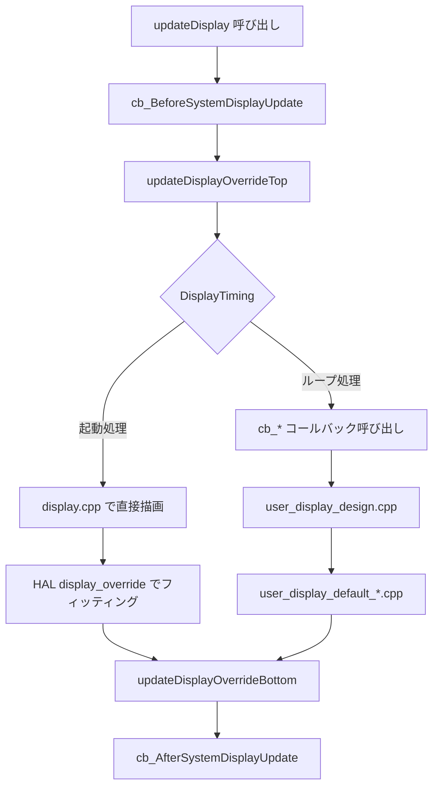

# 画面表示のカスタマイズ方法

## 概要

このドキュメントでは、YRIT IoT Firmware の画面表示をカスタマイズする方法を説明します。

**対象読者**: センサ値の表示方法を変更したい、独自のUIを実装したい開発者

**編集するファイル**: `src/user/user_display_design.cpp`（このファイルのみ編集すればOK）

---

## クイックスタート

最も簡単なカスタマイズ例として、I2Cセンサの値が1000を超えたら警告を表示する実装を紹介します。

### 手順

1. `src/user/user_display_design.cpp` を開く
2. `cb_UpdateI2cValueInt` 関数を見つける
3. 以下のように編集する

```cpp
void cb_UpdateI2cValueInt(std::unique_ptr<OpenFontRender> &render,
                          const char *sensor_name,
                          int32_t value,
                          const char *unit,
                          bool selected) {
    // デフォルト表示を実行
    cb_UpdateI2cValueInt_Default(render, sensor_name, value, unit, selected);

    // 値が1000を超えたら警告表示
    if (value > 1000) {
        HAL.Display.takeSemaphoreMutex(portMAX_DELAY);
        render->setFontSize(14);
        render->setCursor(10, 200);
        render->setFontColor(TFT_RED, TFT_BLACK);
        render->printf("WARNING: High value!");
        HAL.Display.giveSemaphoreMutex();
    }
}
```

これだけで、センサ値が高い時に警告が表示されるようになります。

---

## 基本的なカスタマイズ方法

### カスタマイズの流れ

```
1. カスタマイズしたい表示を決める（センサ値？起動画面？）
       ↓
2. 対応するコールバック関数を探す
       ↓
3. user_display_design.cpp で実装する
```

### 3つの実装パターン

#### パターン1: デフォルト表示をそのまま使用

```cpp
void cb_UpdateI2cValueInt(...) {
    cb_UpdateI2cValueInt_Default(render, sensor_name, value, unit, selected);
}
```

#### パターン2: デフォルト表示 + 追加処理

```cpp
void cb_UpdateI2cValueInt(...) {
    // まずデフォルト表示
    cb_UpdateI2cValueInt_Default(render, sensor_name, value, unit, selected);

    // その後に追加の描画処理
    HAL.Display.takeSemaphoreMutex(portMAX_DELAY);
    // ... 追加の描画 ...
    HAL.Display.giveSemaphoreMutex();
}
```

#### パターン3: 完全に独自実装

```cpp
void cb_UpdateI2cValueInt(...) {
    HAL.Display.takeSemaphoreMutex(portMAX_DELAY);

    // 完全にカスタムの描画処理
    HAL.Display.fillRect(0, 0, 320, 240, TFT_BLACK);
    render->setFontSize(24);
    render->setCursor(10, 10);
    render->setFontColor(TFT_CYAN, TFT_BLACK);
    render->printf("%s: %d %s", sensor_name, value, unit);

    HAL.Display.giveSemaphoreMutex();
}
```

### 描画時の注意点

画面に描画する際は、必ずミューテックスを取得・解放してください。

```cpp
HAL.Display.takeSemaphoreMutex(portMAX_DELAY);  // 開始
// ... 描画処理 ...
HAL.Display.giveSemaphoreMutex();             // 終了
```

これを忘れると、マルチタスク環境で画面表示が乱れます。

---

## コールバック関数一覧

### どの関数を編集すればいいか

| やりたいこと | 編集する関数 |
|-------------|-------------|
| センサ値（整数）の表示を変えたい | `cb_Update***ValueInt` |
| センサ値（小数）の表示を変えたい | `cb_Update***ValueDouble` |
| センサ値（文字列）の表示を変えたい | `cb_Update***ValueString` |
| エラー時の表示を変えたい | `cb_Update***ValueError` |
| 起動完了時の画面を変えたい | `cb_SystemReady` |
| 待機中の表示を変えたい | `cb_WaitTiming` |
| 送信バッファ状態の表示を変えたい | `cb_***BufferUpdate` |

※ `***` の部分は `Gpio`, `I2c`, `Modbus` のいずれか

### 全コールバック関数の詳細

#### センサ値更新

| 関数名 | センサ種別 | データ型 | パラメータ |
|--------|-----------|---------|-----------|
| `cb_UpdateGpioValue` | GPIO | int32_t | sensor_name, value, unit, selected |
| `cb_UpdateI2cValueInt` | I2C | int32_t | sensor_name, value, unit, selected |
| `cb_UpdateI2cValueDouble` | I2C | double | sensor_name, value, unit, selected |
| `cb_UpdateI2cValueString` | I2C | const char* | sensor_name, value, unit, selected |
| `cb_UpdateI2cValueError` | I2C | - | sensor_name, selected |
| `cb_UpdateModbusValueInt` | Modbus | int32_t | sensor_name, value, unit, selected |
| `cb_UpdateModbusValueDouble` | Modbus | double | sensor_name, value, unit, selected |
| `cb_UpdateModbusValueString` | Modbus | const char* | sensor_name, value, unit, selected |
| `cb_UpdateModbusValueError` | Modbus | - | sensor_name, selected |
| `cb_UpdateCameraValue` | Camera | - | sensor_name, selected |

#### サンプリング完了通知

| 関数名 | 呼び出しタイミング | パラメータ |
|--------|------------------|-----------|
| `cb_SamplingGpioSensors` | GPIOセンサ値取得完了時 | timeinfo |
| `cb_SamplingI2cSensors` | I2Cセンサ値取得完了時 | timeinfo |
| `cb_SamplingModbusSensors` | Modbusセンサ値取得完了時 | timeinfo |
| `cb_SamplingCameraSensor` | カメラ撮影完了時 | timeinfo |

#### システム・通信関連

| 関数名 | 呼び出しタイミング | パラメータ |
|--------|------------------|-----------|
| `cb_BeforeSystemDisplayUpdate` | 画面更新の直前 | DisplayTiming |
| `cb_AfterSystemDisplayUpdate` | 画面更新の直後 | DisplayTiming |
| `cb_SystemReady` | 起動完了時 | dev_id, sensor_num |
| `cb_WaitTiming` | 待機時間中 | current_sec |
| `cb_AmbientBufferUpdate` | Ambient送信バッファ更新時 | remain_data_quantity |
| `cb_FtpBufferUpdate` | FTP送信バッファ更新時 | remain_data_quantity |
| `cb_HttpBufferUpdate` | HTTP送信バッファ更新時 | remain_data_quantity |
| `cb_MqttBufferUpdate` | MQTT送信バッファ更新時 | remain_data_quantity |
| `cb_ReadMqttStatus` | MQTT状態変化時 | status |

---

## 処理フローの詳細

画面表示の内部処理を理解したい方向けの説明です。

### 2種類の処理

画面表示は **起動処理** と **ループ処理** の2種類に分かれます。

| 処理 | 説明 | カスタマイズ方法 |
|-----|------|----------------|
| **起動処理** | 初期化メッセージ、WiFi接続状態など | HAL層の `*_display_override.cpp` を編集（上級者向け） |
| **ループ処理** | センサ値表示、バッファ状態など | `user_display_design.cpp` を編集 |

### 処理フロー図



### 呼び出し順序

| 順序 | 関数 | 実装場所 |
|:---:|------|---------|
| 1 | `cb_BeforeSystemDisplayUpdate` | user_display_design.cpp |
| 2 | `updateDisplayOverrideTop` | *_display_override.cpp |
| 3 | **描画処理**（起動 or ループ） | - |
| 4 | `updateDisplayOverrideBottom` | *_display_override.cpp |
| 5 | `cb_AfterSystemDisplayUpdate` | user_display_design.cpp |

---

## 実装例

### 例1: 特定のセンサだけ表示を変える

BME280の温度センサだけ大きく表示し、他はデフォルト表示にする例です。

```cpp
void cb_UpdateI2cValueDouble(std::unique_ptr<OpenFontRender> &render,
                             const char *sensor_name,
                             double value,
                             const char *unit,
                             bool selected) {
    String name = String(sensor_name);

    if (name.indexOf("BME280_Temperature") >= 0) {
        // 温度センサだけカスタム表示
        HAL.Display.takeSemaphoreMutex(portMAX_DELAY);
        HAL.Display.fillRect(0, 60, 320, 100, TFT_BLACK);
        render->setFontSize(48);
        render->setCursor(60, 80);
        render->setFontColor(TFT_YELLOW, TFT_BLACK);
        render->printf("%.1f%s", value, unit);
        HAL.Display.giveSemaphoreMutex();
    } else {
        // その他はデフォルト
        cb_UpdateI2cValueDouble_Default(render, sensor_name, value, unit, selected);
    }
}
```

### 例2: 値の範囲で色を変える

```cpp
void cb_UpdateI2cValueInt(std::unique_ptr<OpenFontRender> &render,
                          const char *sensor_name,
                          int32_t value,
                          const char *unit,
                          bool selected) {
    // 値によって色を決定
    uint16_t color;
    if (value < 500)       color = TFT_BLUE;
    else if (value < 1000) color = TFT_GREEN;
    else if (value < 1500) color = TFT_YELLOW;
    else                   color = TFT_RED;

    HAL.Display.takeSemaphoreMutex(portMAX_DELAY);
    render->setFontSize(20);
    render->setCursor(50, 100);
    render->setFontColor(color, TFT_BLACK);
    render->printf("%s: %d %s", sensor_name, value, unit);
    HAL.Display.giveSemaphoreMutex();
}
```

### 例3: 起動完了画面をカスタマイズ

```cpp
void cb_SystemReady(std::unique_ptr<OpenFontRender> &render,
                    const char *dev_id,
                    int sensor_num) {
    HAL.Display.takeSemaphoreMutex(portMAX_DELAY);

    HAL.Display.fillRect(0, 0, 320, 240, TFT_NAVY);

    render->setFontSize(24);
    render->setCursor(60, 60);
    render->setFontColor(TFT_WHITE, TFT_NAVY);
    render->printf("My IoT Device");

    render->setFontSize(14);
    render->setCursor(80, 100);
    render->setFontColor(TFT_CYAN, TFT_NAVY);
    render->printf("ID: %s", dev_id);

    render->setCursor(60, 130);
    render->setFontColor(TFT_GREENYELLOW, TFT_NAVY);
    render->printf("Sensors: %d", sensor_num);

    HAL.Display.giveSemaphoreMutex();

    HAL.delay(3000);
}
```

### 例4: 送信バッファ状態を色で表現

```cpp
void cb_MqttBufferUpdate(std::unique_ptr<OpenFontRender> &render,
                         int remain_data_quantity) {
    uint16_t color;
    if (remain_data_quantity == 0) color = TFT_GREEN;
    else if (remain_data_quantity < 10) color = TFT_YELLOW;
    else color = TFT_RED;

    HAL.Display.takeSemaphoreMutex(portMAX_DELAY);
    HAL.Display.fillRect(250, 200, 60, 30, color);
    render->setFontSize(12);
    render->setCursor(255, 210);
    render->setFontColor(TFT_BLACK, color);
    render->printf("MQTT:%d", remain_data_quantity);
    HAL.Display.giveSemaphoreMutex();
}
```

---

## リファレンス

### 描画API: OpenFontRender

```cpp
// フォントサイズ設定
render->setFontSize(20);

// フォント色設定（文字色, 背景色）
render->setFontColor(TFT_WHITE, TFT_BLACK);

// カーソル位置設定
render->setCursor(x, y);

// テキスト描画
render->printf("Value: %d", value);
render->print("Hello");
render->println("World");

// カーソル位置取得
int x = render->getCursorX();
int y = render->getCursorY();
```

### 描画API: HAL.Display

```cpp
// ミューテックス管理（必須）
HAL.Display.takeSemaphoreMutex(portMAX_DELAY);
HAL.Display.giveSemaphoreMutex();

// 図形描画
HAL.Display.fillRect(x, y, width, height, color);   // 矩形塗りつぶし
HAL.Display.drawRect(x, y, width, height, color);   // 矩形枠線
HAL.Display.fillCircle(x, y, radius, color);        // 円塗りつぶし
HAL.Display.drawLine(x1, y1, x2, y2, color);        // 線
HAL.Display.fillScreen(color);                       // 画面全体塗りつぶし
```

### 色定数

| 定数 | 色 |
|-----|---|
| `TFT_BLACK` | 黒 |
| `TFT_WHITE` | 白 |
| `TFT_RED` | 赤 |
| `TFT_GREEN` | 緑 |
| `TFT_BLUE` | 青 |
| `TFT_CYAN` | シアン |
| `TFT_YELLOW` | 黄 |
| `TFT_ORANGE` | オレンジ |
| `TFT_NAVY` | ネイビー |
| `TFT_GREENYELLOW` | 黄緑 |

### 画面サイズ別の実装

対応画面サイズとプリプロセッサ定義：

| 解像度 | プリプロセッサ定義 | デフォルト実装 |
|-------|------------------|---------------|
| 128×128 | `DISPLAY_128X128` | `user_display_default_128x128.cpp` |
| 240×135 | `DISPLAY_240X135` | `user_display_default_240x135.cpp` |
| 222×480 | `DISPLAY_222X480` | `user_display_default_222x480.cpp` |
| 320×240 | `DISPLAY_320X240` | `user_display_default_320x240.cpp` |

画面サイズごとに処理を分ける場合：

```cpp
void cb_UpdateI2cValueDouble(...) {
#ifdef DISPLAY_320X240
    render->setFontSize(24);
    render->setCursor(50, 100);
#elif defined(DISPLAY_128X128)
    render->setFontSize(12);
    render->setCursor(10, 50);
#else
    cb_UpdateI2cValueDouble_Default(render, sensor_name, value, unit, selected);
    return;
#endif
    // 共通の描画処理...
}
```

---

## ファイル構成

```
src/
├── display/
│   ├── display.cpp              # 起動処理の描画（変更不要）
│   └── display.h
│
├── hal/hardware/*/
│   └── *_display_override.cpp   # デバイス固有のフィッティング（上級者向け）
│
└── user/
    ├── user_display_design.cpp  # ← カスタマイズはここ
    └── user_display_default/
        └── user_display_default_*.cpp  # 解像度別デフォルト実装（参考用）
```
